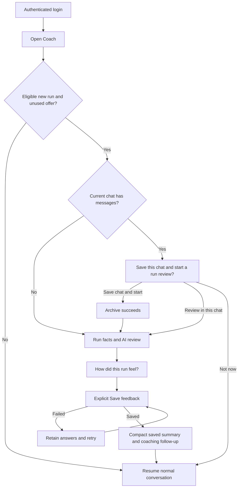

# ORBIT post-run review — UX design specification

28 October 2026 · Proposed extension for product review · No application changes  
[Business requirements](../product/POST_RUN_REVIEW_BRD.md) · [Open interactive prototype](post-run-review/index.html)

## Experience goal

“ORBIT knows the run I just did, gives me a useful review, listens to how it felt, and remembers that I answered.”

Use the attached Strava image's conclusion-first hierarchy and simple action, within the approved ORBIT graphite shell and light glacier conversation surface. Retain the existing approved avatar. Do not reproduce Strava branding, its orange theme, or unsupported claims from the screenshot.

All prototype workouts, dates, summaries and conversations are synthetic design examples. RPE begins unselected. The prototype stores demonstration state in memory only and makes no AI or application requests.

## Screen flow



Presenting either the chat-choice dialog or opening review consumes the login's automatic offer. Back, close and Not now suppress further automatic offers that login. After save, activity-scoped completion suppresses the run on every later login. Manual review remains available. The full decision table and concurrent-device limits are in the BRD.

## Layout and hierarchy

| Region | Desktop ≥1100px | Phone <768px |
| --- | --- | --- |
| Application shell | Existing dark rail/navigation; Coach selected | Compact header and existing bottom navigation |
| Page identity | Coach, date and small ORBIT identity | Compact Coach heading; avatar stays small |
| Primary surface | Light glacier, maximum reading column 720px; contextual next-session rail optional | Full-width surface with 16px gutters |
| Run identity | New run label; title, local date, source | Same information; title/date wrap naturally |
| Facts | Four columns: distance, moving time, moving pace, elevation | Two columns; maintain labels and units |
| Review | Short strong takeaway, 60–110-word explanation, one next step | Same reading order; scroll as needed |
| Evidence limit | Visible near interpretation | Never hidden inside disclosure |
| Actions | One filled primary per step; secondary text actions | Full-width primary; secondary below; ≥44px targets |
| Feedback | Same surface, progressively revealed after review | One-column form; RPE as two rows of five |
| Saved state | Compact feedback summary in transcript; normal composer | Same; expanded form and “new” invitation disappear |

Preserve `/dashboard` Home and `/dashboard/coach` Coach separation from the later accepted ADR amendment. The prototype's sidebar/context are illustrative; this proposal adds no navigation destination or global shell redesign.

Normal state order:

```text
COACH                                    Previous chats
ORBIT · AI coach                         [small avatar]

NEW RUN · Wed 28 Oct · 16:10
Afternoon run
12.2 km       1:33:08 moving       7:38/km moving       +226 m

ORBIT'S RUN REVIEW                                      AI
A longer run, with more climbing to account for
One useful explanation based on known evidence.
Next step: Tell me how the effort felt.
Evidence limit: Heart-rate data is unavailable. Effort is not yet known.

[Tell ORBIT how it felt]                 Not now
View activity · What informed this review
```

A material caveat remains beside the relevant claim. The evidence disclosure can explain the source/review date and limitations in more detail; it cannot be the only place uncertainty appears. Facts must state whether duration and pace use moving or elapsed time. Do not mix them silently.

## State 1 — New run, ready review

The first content names the run and shows the review, not a generic greeting or an empty composer. Use “You completed Afternoon run on Wed 28 Oct” only for a recorded completed activity, without asserting plan adherence. Existing published assessment is reused, not generated again on every visit.

Primary: **Tell ORBIT how it felt** → feedback step. Secondary: **Not now** → normal chat with a quiet manual resume action. **View activity** opens the exact record and restores the review/context/focus on return. The normal composer stays available in the actual Coach layout; this review is the opening conversation content.

## State 2 — Existing conversation

Use a labelled confirmation dialog on desktop and a bottom-aligned dialog/sheet on phone. Underlying conversation is inert, never deleted or replaced before selection.

**Title:** “Save this chat and start a run review?”  
**Body:** “Your Afternoon run is ready to review. I can save this discussion in Previous chats and start a fresh one for this run.”

- Primary **Save chat & start review**: archive the entire discussion, preserve the draft, then select the exact run and show its review.
- Secondary **Review in this chat**: append the run-review context without archiving. Clearly label the switch to this run.
- Tertiary **Not now**, close or Escape: keep the discussion and suppress the automatic offer for the rest of this login.

Focus begins at the dialog title, stays trapped while open, and returns to the launching context after cancellation. Close and Escape follow Not now semantics. Show “Saving chat…” during archive. On failure, retain the discussion and show **Retry saving chat** plus the inline-review alternative. On a concurrent update, refresh state and require a fresh choice; never archive unexpected newer messages. A provider reply in flight uses existing generation fencing when archiving.

Avoid a button labelled only **Clear**: it hides the existing save behaviour. Permanent history deletion remains in Settings.

## State 3 — Athlete feedback

Keep the run title/date and a concise metrics strip at the top. Replace the expanded review with a compact summary and **Read run review** disclosure so the athlete can refer back without leaving the form.

**Heading:** “How did this run feel?”  
**Intro:** “Your watch records the run. You tell me the effort.”

1. **Overall effort (RPE)**: ten labelled radio buttons, 1–10, no preselected value. Explain “Rate the whole run, not just its hardest moment.” Include text anchors and a mutually exclusive **I can't rate it** choice. Selection visibly shows the number and description. Do not prefill from heart rate or target effort.
2. **Any discomfort or pain?**: None / Discomfort / Pain / Prefer not to say. No default. After Discomfort/Pain, reveal optional body area, severity (separate from RPE), affected-running answer and note. Show a calm acknowledgement; never give a diagnosis.
3. Optional **Energy afterwards** and **Compared with your expectation** choices. “Skip” is a real answer, not a zero score.
4. Optional **What should ORBIT know?** multiline note with a 1,000-character limit and visible count.
5. **Fuel, fluids & race notes** progressive disclosure only when relevant (race or ≥75 moving minutes). No extra required questions.

Primary: **Save feedback**. Secondary: **Back to review** and **Finish later**. Do not label this **Send**: it writes a structured record, whereas a normal chat reply does not. Explain “Saves to this run. Your training plan stays as approved.”

On submit, validate RPE/explicit unable answer and discomfort/explicit skip. Focus the first invalid group and associate errors with it. Keep the button usable for triggering accessible validation; prevent duplicate submission during saving. Preserve answers when switching to the review or returning from activity detail. Navigating away suppresses further automatic invitations this login but retains an authorised draft for manual resume.

## State 4 — Feedback saved

Replace the expanded form with **Feedback saved** and a compact summary: “RPE 5/10 · No discomfort · Energy okay”, or honest unavailable/skip labels. Include **Edit your feedback** as a secondary action. Never display a number the athlete did not submit.

ORBIT then gives a short feedback-aware reply, separating subjective answers from recorded metrics: “You rated it 5/10 and reported no discomfort. That helps me interpret the effort alongside the climbing.” Recommendations must use current approved context and remain advice.

Do not show another **How did it feel?** invitation, a blocking success modal, or an automatic review of the next older run. A later new run can have its own review under the per-login rule. The saved summary is ordinary history, not an outstanding task. Normal Ask ORBIT and preparation remain available.

If the follow-up is delayed: “Your feedback is saved. ORBIT's response is still being prepared.” If it fails: keep the saved summary and offer **Retry response** without asking for the form again.

## State 5 — Pending and failures

| State | Copy / action | Preserve |
| --- | --- | --- |
| Review queued/processing | “Your run is synced. ORBIT's review is being prepared. You can share how it felt now.” | Facts, form and normal chat |
| No review requested | “The recorded run is ready. An AI review is not available yet.” Existing supported request action where enabled | Feedback independent of AI |
| Stale review | “This earlier review does not include the latest workout changes.” | Earlier review labelled; current facts |
| Feedback save fails | “Your feedback wasn't saved. Your answers are still here.” **Try saving again** | All entries and request identity |
| Save outcome unknown | “Checking whether your feedback saved…” | Entries; reconcile before a new write |
| Revision conflict | “This run or its feedback changed elsewhere. Review the latest version before saving.” | Unsaved draft, current server summary |
| Run deleted | “This run is no longer available.” Return to conversation/history | Draft note for deliberate recovery; no reassignment |
| Authentication lost | “Sign in again to continue.” | Hide private content; clear private browser drafts |
| No new run / completed run | Normal conversation/preparation | No automatic run-review sheet |

## Interaction, visual and accessibility details

- Graphite shell `#17232d`; glacier canvas `#f5f8fa`; white cards; primary deep teal `#096575`; main text `#172b38`; supporting text `#52646f`. Reuse production semantic tokens at implementation rather than introducing global overrides.
- Body 16px, supporting text 14px, takeaway 24–28px, line-height 1.5. Use 8/12/16/24/32px spacing and restrained borders. No decorative scores or performance gauges.
- Desktop reading width 660–720px; form width ≤720px. Mobile 16px gutters. Targets ≥44px with distinct focus rings; wrap long source/title values.
- Use native radio groups and fieldsets. RPE number plus text identifies selection; do not rely on a red/green gradient. Announce the saved/error state politely without re-reading the entire chat.
- Preserve existing independent transcript scrolling and reachable composer/navigation. The form can grow vertically; never squeeze text or clip caveats to achieve a one-screen mockup. At small heights/zoom, allow the page to scroll.
- Dialog has an accessible name, focus containment, Escape handling and restored focus. Respect reduced motion; no mandatory animation.

## Prototype review guide and limits

Open [the prototype](post-run-review/index.html). Use the design controls to inspect **New run**, **Existing chat**, **AI pending**, and **Save error**. Complete RPE and discomfort, then save; use **Simulate next login** to check that a completed run does not reappear. Defer first, then simulate another login to see it return. **Another new run** demonstrates a different activity. **Phone layout** previews the narrow composition; use an actual narrow browser for reflow checks.

The prototype demonstrates the main path, inline/archived conversation choice, explicit form validation, inability/skip options, pending AI, failed save, deferral and completion suppression within the open tab. Secondary fuel/race/symptom questions show progressive disclosure. It does not call archive, AI, feedback or authentication services; simulate controls are outside product UI. Production requires the BRD's authoritative persistence, multi-tab protection, revision fencing, navigation and recovery acceptance.

Design review checks: the run is identifiable before feedback; the first takeaway is legible; the form is quick to complete without invented inputs; archive meaning is clear; completed feedback removes the invitation; and phone controls remain reachable. Architecture follows this design review before application changes.
