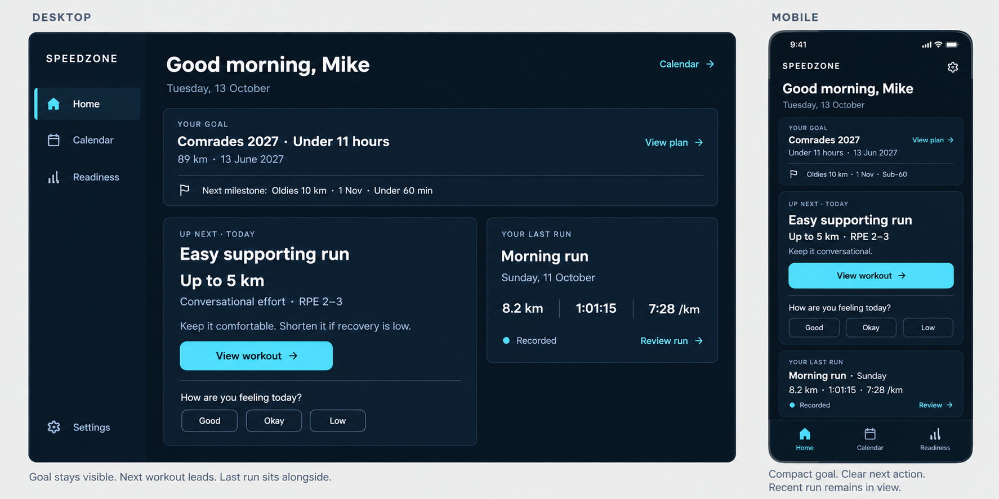

# Home daily briefing: implementation plan

Date: 13 October 2026 (Africa/Johannesburg).
Status: implementation and browser verification complete. TypeScript, unit tests and the Next.js production bundle pass; the complete build remains blocked at Prisma engine download. See [Execution handoff](#execution-handoff).

## Approved outcome

Home should make three things clear at a glance: the goal, the next workout, and the latest recorded activity. Implement the owner's approved desktop/mobile diagram, with the subsequent milestone placement amendment below. Preserve its proportions, dark navy surfaces, restrained cyan actions, and all approved buttons. Preserve the existing Speedzone logo rather than replacing it with the illustration's wordmark.



The image is a visual reference, not a source of athlete records or workout advice. The latest milestone placement instruction supersedes its full-width milestone strip.

### Final milestone placement

- Desktop: main Comrades goal at the left of the compact goal banner; a small **Next milestone** area to its right; retain **View plan** as a quiet action. Show the race name and goal in smaller type, with no independent bordered/purple panel.
- Mobile: show that same milestone underneath the main goal, within the same compact banner. Keep the race name and goal together, with natural wrapping when needed.
- Initial Home summary shows the nearest upcoming approved race milestone. The existing Plan destination exposes the remaining milestones; no new milestone page or expanding list is required for this pass.
- Design example: **JGS Oldies 10 km · Under 60 minutes**. The owner supplied this desired display name; the race identity, distance and target must still be tied to the approved milestone. Do not rewrite stored approval artifacts to make an example match.
- Routine milestone content is race name and target only. Its date can stay in Plan. Preserve the main goal's date as in the approved diagram.

### Layout and controls

| Area | Desktop | Mobile |
| --- | --- | --- |
| Navigation | Left sidebar: Home, Calendar, Readiness; Settings at bottom | Existing compact brand header with Settings; fixed bottom Home / Calendar / Readiness |
| Header | Personal greeting, local date, quiet Calendar link | Compact greeting and local date |
| Goal | Slim full-width banner; main goal left, smaller milestone right | Compact goal banner; smaller milestone beneath goal |
| Main content | Next workout about 60% width; latest activity about 40%, separated by approximately 20px | Workout first, compact latest activity directly below |
| Workout action | Cyan **View workout →** | Same button, full available width |
| Recovery | **How are you feeling today?** and **Good / Okay / Low** within workout surface | Same controls within workout surface |
| Latest activity | Recorded facts, understated **Recorded** indicator, **Review run →** for a run | Compact recorded facts and **Review →** |

Use a shared DOM reading order: greeting, goal and milestone, workout with check-in, latest activity. CSS controls the desktop columns. One component tree must serve both layouts, avoiding duplicated IDs and duplicate fetches.

## Current architecture and scope

The app is Next.js 16.3 with React/TypeScript. `apps/web/app/dashboard/page.tsx` chooses local/mock analytics or `OnlineDashboardShell`. `DashboardShell` currently owns both Home composition and the `#readiness` disclosure. `HomeGoalContext`, `TodayCoachingCard` and `HomeRecentTraining` already read their respective APIs. `DailyWellbeingCheckIn` already persists answers through the journal API.

This release is a frontend composition and navigation change using existing authenticated, athlete-scoped APIs. No database migration, new prediction model, new backend service, or change to approval/publication contracts is needed.

The latest user decision supersedes the older design requirement for exactly two primary destinations, the vertically stacked desktop groups, persistent Home adherence/performance placeholders, and the larger milestone presentation. During implementation, record a dated amendment in `docs/design/DESIGN_INTENT_CONTRACT.md` and link this plan. Retain the existing domain, evidence, accessibility and detail-preservation requirements. Previous plan documents remain historical references.

## Component and route design

| File or boundary | Planned responsibility |
| --- | --- |
| `apps/web/app/dashboard/page.tsx` | Render the Home experience without waiting for prediction analytics |
| `components/dashboard/dashboard-shell.tsx` | Compose greeting, compact goal banner and responsive workout/activity grid; retain Home return/focus behavior |
| `components/dashboard/home-goal-context.tsx` | Keep verified goal-context fetching and state distinctions; present compact goal and milestone; remove readiness launcher and routine assessment/narrative placeholders |
| `components/coaching/today-coaching-card.tsx` | Add an explicit Home presentation variant with approved button treatment; retain existing full/detail rendering and schedule semantics |
| `components/coaching/daily-wellbeing-check-in.tsx` | Add a compact quick-answer variant backed by the same journal save behavior; preserve full check-in editing |
| `components/dashboard/home-recent-training.tsx` | Present latest recorded facts compactly and preserve existing activity-review destination and return context |
| `components/dashboard/dashboard-navigation.tsx` and `dashboard-navigation-state.ts` | Add Readiness destination/icon/current state and three-column compact navigation |
| New `apps/web/app/dashboard/readiness/page.tsx` and Readiness shell/content | Host the existing current-fitness estimate, distance selector, evidence, freshness, errors and data-quality links |
| `components/dashboard/online-dashboard-shell.tsx` and analytics loader boundary | Extract/reuse online analytics loading for Readiness; remove its global analytics splash dependency from Home |
| `lib/recovery-context.ts` | Allow `/dashboard/readiness`; preserve estimate selection, return path, scroll and focus through supporting details |
| `components/dashboard/dashboard.css` and relevant coaching CSS | Implement scoped responsive layout, restrained surfaces and readable typography |
| `lib/home-summary.ts` or a small adjacent presentation helper | Deterministic milestone selection and structured display formatting, with no persisted derived records |

New components should be small responsibility boundaries, not a rewrite of the dashboard or Calendar. Read the installed Next.js guides required by `apps/web/AGENTS.md` before application edits.

### Readiness routing and compatibility

Use `/dashboard/readiness` as a normal navigation destination. Extract the existing evidence presentation rather than copying its JSX into two maintained implementations. Reuse the same local data source, online overview, view model and evidence helpers.

Preserve old `/dashboard#readiness` links with a client-side compatibility redirect using history replacement. Fragments are unavailable to the server. Preserve validated recovery parameters and old saved disclosure contexts, mapping their focus target to an appropriate Readiness control. Returning from data-quality review must restore the selected estimate distance, scroll and focus on Readiness. Keep ordinary browser Back behavior and an explicit Home destination for directly opened Readiness.

Home must not fetch or wait for readiness analytics or sync status. Goal, workout, activity and check-in reads remain independent; failure in one area must not hide the others.

## Data and behavior contracts

### Goal and milestone

Continue using `GET /api/v1/coaching/goal-context/active`, including its verified plan/goal identities and ready, goal-only, no-plan, pending and unavailable states. Show a short, actionable message in the affected area on genuine failure; remove routine "unassessed", "no race-day assessment" and "purpose unavailable" scaffolding from the healthy Home view.

Choose the nearest milestone on or after today in the saved plan timezone, sorted by date with a deterministic ID tie-break. Recompute on focus and date rollover. Do not treat a past milestone as completed. No upcoming milestone yields a quiet short message rather than an empty large panel.

Prefer the approved event name for the race label, without repeating event name plus title plus distance. Where an approved name is unavailable, retain the complete approved title; do not strip words heuristically. Use the approved target wording when available; a numeric target alone should display as **Target 60 min**, not silently invent a strict "under" comparator. The user-approved sub-60 example applies when backed by that milestone's approved target wording. Full goal narrative and complete milestone detail remain reachable via **View plan**. Consistency goals and goals without time targets still render correctly.

Greeting uses an existing authenticated/profile display name when available; otherwise use a neutral greeting. Do not hardcode Mike. Dates use the established saved IANA timezone, defaulting consistently to Africa/Johannesburg when none is supplied. Avoid competing goal/workout timezone callbacks overwriting each other unpredictably.

### Next workout

Reuse `GET /api/v1/coaching/today`. For an effective active workout today, show its approved title, structured facts when supplied, prescription and necessary cautions. Keep **View workout** linked to the existing date/session-specific Calendar detail.

For prescribed rest, clearly show the recovery day and the supplied next workout if present. An unscheduled day is distinct from prescribed rest. Completed, skipped or missed sessions must not be relabeled as an upcoming workout. Use the API's verified next-workout fields when applicable; do not compute session completion from a same-day recorded run. Older responses without schedule classification retain a truthful Calendar fallback.

Do not parse free-form prescriptions with ad hoc regular expressions just to reproduce the illustration's distance/RPE line. Use trusted structured values or present the complete approved prescription. The sample coaching instruction is not automatic advice to add to every workout. Keep essential warnings visible; optional full rationale and history remain in Calendar. Skip the unused weekly-calendar request in the Home-only presentation.

### Recovery buttons

Keep the approved **Good / Okay / Low** controls and map them explicitly to the existing `overallFeeling` enum: `good` / `normal` / `poor`. A tap saves this answer through `PUT /api/v1/wellbeing-check-ins/[date]`, using the current `expectedRevision` and saved timezone. Retain all other existing answers; change an explicitly skipped entry to saved only after a user chooses an answer.

Nothing is preselected or written on page load. Disable repeat submission while saving; show a compact saved confirmation only after success; announce failure and allow retry. A revision conflict must reload the current record before retry, preserving existing answers rather than blindly overwriting them. Saved `very_good` or `very_poor` answers must retain their exact meaning and remain editable in the existing full check-in; do not collapse or rewrite them on read. The full form is reachable through a contextual edit/details control after a saved check-in. Check-in choices do not automatically amend training.

### Latest recorded activity

Keep the actual latest recorded activity across supported sports; use **Your last run** only when it is a run, otherwise **Latest activity** with sport-appropriate facts and review label. Preserve deterministic activity selection and existing review links, activity-detail flow, browser modifier-click behavior and return focus.

Show date, distance, elapsed duration and pace when those facts exist; avoid duplicated title/date strings. Do not invent a training takeaway or substitute an older reviewed run. The approved compact baseline uses recorded facts without a commentary paragraph. If a short existing takeaway is retained, it must remain complete with its material limits; otherwise omit it and keep the full review available. No missing-takeaway placeholder is required on healthy Home.

## Responsive and accessibility specification

- Keep the existing compact-navigation breakpoint at 768px. At 1100px and above, use the two-column main area and side-by-side goal/milestone. At intermediate widths, stack where needed; never squeeze columns to preserve a screenshot.
- Start with approximately 20px desktop and 14–16px mobile surface padding. Preserve the illustration's proportions rather than its raster pixel dimensions.
- Goal title approximately 22–26px desktop and 19–22px mobile; milestone race/target 14–16px, visibly subordinate but readable; body prescription text at least 16px. Use real semantic labels rather than CSS-generated content.
- Maintain 44px minimum interaction targets even when labels are smaller. Cyan filled workout action remains the strongest control; secondary links and check-in choices stay quieter.
- Aim to show goal, workout/action, check-in and latest-activity summary together at 1440×900 and 390×844 with ordinary concise data. Also inspect 390×780 to match the diagram's approximate mobile shape. Treat these as measured reference cases, not fixed-height containers.
- At 320px, 200% zoom, large text or long prescriptions, allow vertical scrolling. No horizontal overflow, text clipping, line clamps hiding instructions, or content trapped behind the fixed bottom navigation. Respect safe-area insets.
- Preserve semantic headings, skip link, keyboard focus, screen-reader selected/saving state, contrast, reduced motion and focus restoration. Keep navigation labels visible alongside icons.

## Implementation sequence and completion gates

| Step | Deliverable | Completion gate |
| --- | --- | --- |
| 1. Record scope | Dated design-contract amendment and reference link | Latest milestone placement and Home/Calendar/Readiness navigation documented |
| 2. Separate Readiness | Dedicated route and shared analytics/evidence loading; old-link compatibility | Local and online Readiness retain existing states; Home renders without analytics dependency; recovery return works |
| 3. Recompose Home | Greeting, compact goal/milestone banner, desktop workout/activity grid and mobile stack | Diagram proportions/actions and latest placement amendment implemented; independent read states preserved |
| 4. Wire check-in and actions | Good/Okay/Low persistence, View workout/plan/review links and focus restoration | Correct saved journal value, other answers retained, failures/conflicts handled, no incidental writes |
| 5. Verify and document | Updated meaningful tests, viewport evidence and implementation handoff | Acceptance cases below pass; screenshots reviewed against reference; limitations recorded |

Dependencies: step 1 precedes application changes; step 2 establishes the simplified Home boundary; steps 3 and 4 complete the experience; step 5 verifies the integrated release. No deployment is included in this planning request. A later implementation handoff should list changed files, executed checks, screenshots, and any actual unresolved issues. Rollback restores the previous frontend composition and navigation; retain existing journal records and approved plan data.

## Validation plan

Update existing assertions that require three vertically stacked desktop groups, two navigation tabs, or an in-Home Readiness button. Replace them with geometry and behavior assertions for the approved design rather than merely removing checks.

- Extend navigation and recovery-context unit tests for the Readiness route, old fragments, allowed return path, distance selection and focus restoration.
- Add focused presentation tests for milestone selection at the Johannesburg date boundary, past/no milestones, duplicate display labels, target wording, missing goal fields and non-run latest activity. Reuse existing Today schedule-state coverage.
- Exercise real check-in requests against isolated fixtures: Good/Okay/Low mappings, preserved other answers, save failure, revision conflict, skipped state and exact saved extreme values. An initial visit and every ordinary navigation/review action must perform no application writes.
- Update `redesign-home.spec.ts`, `home-layout-assertions.ts` and accessibility tests for desktop columns, mobile milestone placement, all three summary areas, touch targets, no overflow, independent failures and real deep-link/Back behavior.
- Cover 1440×900 desktop; 390×844 and 390×780 mobile; 320, 768 and 1024px reflow; 200% zoom; long prescription/name; goal pending/error; prescribed rest/unscheduled/completed/skipped/missed; no activity; no review; unavailable analytics. Use deterministic fixture dates with an explicit timezone.
- Run the existing web unit suite and TypeScript check, targeted local Playwright Home/Readiness suites, online-fixture coverage and accessibility scans; finish with the web production build. Use the established isolated fixture setup, not the athlete's real data. Exact test selection is recorded in the handoff.

Acceptance: the revised goal/milestone banner, next workout and latest activity are immediately understandable; all approved controls work; Readiness is separate; recorded facts and approved training retain their meaning; ordinary reference cases fit together without sacrificing readable text or necessary cautions.

## Execution handoff

Implemented the approved Home composition in one responsive component tree: a compact goal banner with the nearest approved milestone beside it on desktop and beneath it on mobile; the workout and Good / Okay / Low recovery check-in share one surface; latest recorded activity has a compact fact summary and its existing review path. Readiness now has its own `/dashboard/readiness` route and primary navigation entry. Legacy `/dashboard#readiness` links redirect to that route, and saved recovery returns retain their selection, scroll and focus context. Settings remains in secondary navigation and becomes an icon control on mobile.

The quick check-in maps Good / Okay / Low to the existing `good` / `normal` / `poor` values, keeps other recorded answers, and only writes after an explicit choice. Milestone selection uses the nearest non-past date in the approved plan timezone, with a stable ID tie-break; the display takes the event label and target wording from the approved milestone fields. No schema, API, migration or stored approval artifact changed.

The verification pass refined phone spacing and button styling, preserved complete workout prescriptions, and confirmed that the ordinary goal/workout/check-in/activity summaries fit at 390×844 and 1440×900. Smaller screens scroll normally above the fixed navigation. The date refreshes across local midnight and on focus; approved plan timezone takes precedence. Quick check-ins preserve saved answers, discard cancelled form drafts, and block retry after a failed conflict refresh until the current record has loaded.

Verification completed:

- `npm run typecheck --workspace @racepredictor/web` passed.
- `npm test --workspace @racepredictor/web` passed all 38 tests.
- Home Playwright: all 26 cases passed across the full run (25 passing) and the remaining responsive-case rerun. That case initially measured during smooth scrolling; the geometry helper now explicitly uses instant scrolling before measurements, without changing bounds. Coverage includes 320, 390, 768, 1024 and 1440px widths, 390×780 and 390×844 phones, accessibility, navigation, journal persistence/conflicts, and local midnight.
- Readiness Playwright: all 6 cases passed, covering its dedicated route, evidence, legacy links, distance selection, recovery focus, Data Quality and responsive layout.
- The isolated Next.js production bundle passed with `NEXT_TELEMETRY_DISABLED=1 RACEPREDICTOR_NEXT_DIST_DIR=.next-home-production-check npx next build --webpack` from `apps/web`.
- `git diff --check` passed.

Browser verification used the installed `/usr/bin/chromium`, isolated local fixtures and intercepted API responses. It did not validate a live production journal or online database. Both local Playwright configs now accept the optional `PLAYWRIGHT_CHROMIUM_EXECUTABLE_PATH` environment variable; their default browser behavior is unchanged. Reproduce from `apps/web`:

```sh
PLAYWRIGHT_CHROMIUM_EXECUTABLE_PATH=/usr/bin/chromium RACEPREDICTOR_E2E_RUN_ID=home-verification npx playwright test --config playwright.home.local.config.ts
PLAYWRIGHT_CHROMIUM_EXECUTABLE_PATH=/usr/bin/chromium RACEPREDICTOR_E2E_RUN_ID=readiness-verification npx playwright test --config playwright.readiness.local.config.ts
```

Reviewed previews use deterministic test data, not the athlete's actual records:

- [Desktop, 1440×900](references/home-daily-briefing/verified-home-desktop.png)
- [Mobile, 390×844](references/home-daily-briefing/verified-home-mobile.png)

The complete `npm run build --workspace @racepredictor/web` remains blocked at Prisma generation: fetching the engine from `binaries.prisma.sh` returns HTTP 403. Playwright's CDN download was also blocked, but the installed system browser enabled the checks above. No deployment was performed.
