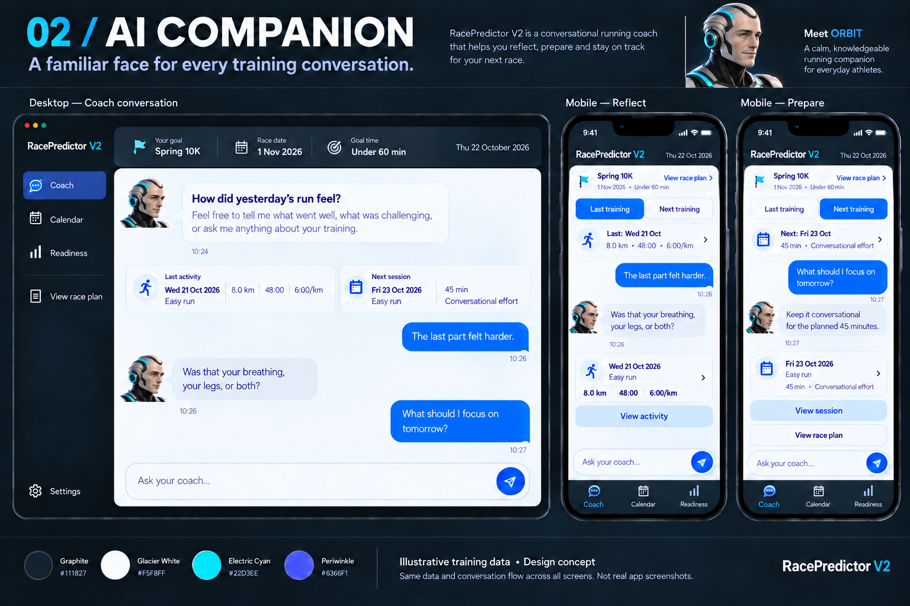
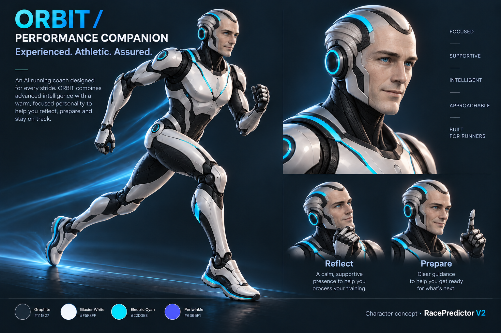

# V2 AI Companion: Approved Layout and Design Handoff

Date: 22 October 2026\
Status: Product Owner approved the visual direction and final images. The first iteration now derives and uses static ORBIT assets in the online Coach interface.\
Audience: Architect, UI/UX designer, and implementing engineer.\
Product scope: [V2 product design](../product/V2_PRODUCT_DESIGN.md) · [First iteration](../product/V2_FIRST_ITERATION.md) · [User-flow diagrams](../product/V2_FLOW_DIAGRAMS.md).

## 1. Decision to carry into the architecture plan

Build the V2 Coach experience using **AI Companion**, with **ORBIT as a mature, athletic, sophisticated male humanoid coach**. Use the final, more humanoid character: natural facial contours, blue eyes, subtle age lines, a composed expression, silver cybernetic temple framing, and restrained cyan details. The graphite outer application shell and light glacier conversation area are the approved visual relationship.

The Product Owner accepted these images for use on the site when built. Preserve the approved likeness, palette, and interface composition. Earlier toy-like, female, and fully metallic-faced versions are historical references rather than implementation targets. Night Ops and Field Notes are no longer competing implementation options.

This document is the selected design's architecture input. Its written interaction, accessibility, and data rules take precedence over incidental details or generated text in the reference pictures. Measurements and colour values below are implementation baselines to validate, not a claim that a production-ready design system has already been exported.

### Approved interface reference



### Approved ORBIT character reference



## 2. Asset manifest and image use

The dated copies below pin the approved designs independently of later gallery revisions. Both are RGB PNG images, 1536 × 1024 pixels.

| Asset | Repository source | Intended use |
| --- | --- | --- |
| Approved interface board | [2026-10-22-ai-companion-ui.png](../design/v2-concepts/approved/2026-10-22-ai-companion-ui.png) | Layout and style reference for real HTML components. |
| Approved character sheet | [2026-10-22-orbit-character.png](../design/v2-concepts/approved/2026-10-22-orbit-character.png) | Approved likeness and source for site character assets. |
| Current comparison gallery | [Gallery](../design/v2-concepts/index.html) | Design review only; not the deployed application. |

Approved-source SHA-256 values:

```text
2026-10-22-ai-companion-ui.png
0f4a79900a4efe671a949f019a25748ed6af49c233577634da74310d2f6bb745

2026-10-22-orbit-character.png
2558030f16cdcf569a42eeff67d949d600835421869cca306df4aa3f7d6af55a
```

The boards contain presentation headings, sample training data, browser/device frames, and multiple views. Implement the actual interface using text, buttons, cards, and accessible navigation. The presentation-board title, palette swatches, device bezels, and character-sheet captions are not application chrome. Keep the existing real RacePredictor brand assets; the generated wordmark is not a new logo instruction.

The first iteration prepares static derivatives from the approved likeness:

| Proposed production asset | Export guidance | Placement |
| --- | --- | --- |
| `orbit-avatar.webp` | 256 × 256 WebP head crop with a clean glacier-compatible background, derived from the approved character sheet. | Coach-message avatar, rendered at 30–48 CSS px. |
| `orbit-portrait.webp` | 768 × 805 WebP head-and-shoulders crop preserving face and temple detail. | Available for a later quiet arrival identity treatment; current interface uses the compact avatar. |
| Full-body illustration | Optional separate cutout only if a later approved placement needs it. | The first-iteration conversation does not need a full-body hero. |

Use WebP/AVIF where appropriate, with a supported fallback and alpha handling. Store application derivatives in the project's static-asset pipeline at `apps/web/public/images/orbit-avatar.webp` and `apps/web/public/images/orbit-portrait.webp`. Keep reference boards in `docs`. Do not serve the complete character sheet as every avatar or rely on a live image-generation service.

Preserve intrinsic aspect ratios, reserve layout space, and supply responsive sizes. Verify the face at its actual 32–48 px display size. A missing image falls back to an ORBIT initials mark without blocking conversation. The label **ORBIT · AI coach** remains readable independently of the image. Static imagery is sufficient for iteration one; no animation or extra character states are required.

## 3. Application structure and navigation

One new conversation-led Coach experience replaces the V2 Home composition at `/dashboard`. Arrival, reflection, preparation, and resumption are states of this screen, not separate chat routes.

| Destination | Route | V2 responsibility |
| --- | --- | --- |
| Coach | `/dashboard` | Default entry, conversation, training context, and contextual actions. Rename the Home navigation label to Coach. |
| Calendar | `/dashboard/calendar` | Existing calendar, date/session detail, and permitted schedule actions. |
| Readiness | `/dashboard/readiness` | Existing analytical evidence and its limitations. |
| Race plan | `/dashboard/plan` | Existing goal, approved plan, proposals, approval, and plan management. Reachable through **View race plan** without sending a message. |
| Activity detail | Existing activity route/selection | Existing shared activity detail with the selected recorded activity. |
| Settings | `/dashboard/settings` | Secondary utility; existing preferences, connections, and management entry points. |

Keep existing URL and authentication behaviour. Calendar and Readiness remain primary navigation destinations; Settings stays secondary. The concept board's extra race-plan shortcut does not require a fourth primary tab. Use the persistent **View race plan** action in the goal orientation, with an optional desktop utility shortcut only if it reuses the existing shell pattern.

Calendar, activity detail, and race-plan management retain their current functionality and design in iteration one. Light Coach content is deliberately contained inside the dark application shell so existing dark destinations feel related. Do not apply light content tokens globally to those views.

## 4. Desktop layout

Reference viewport: **1440 × 900**, with a second check at 1440 × 1000. Preserve current shell behaviour: the existing default rail token is 220 px, and the current intermediate layout uses 160 px between 768 and 1099 px. Do not infer navigation widths from the scaled screenshot inside the board.

Main content uses the available width within the current 1280 px content maximum, with approximately 24 px outer gutters. The content hierarchy is:

```text
Dark application shell
├── Existing brand / navigation rail
│   ├── Coach, Calendar, Readiness
│   └── Settings
└── Coach main content
    ├── Compact page identity and local date
    ├── Dark goal strip: race, date, approved target, View race plan
    └── Light conversation surface
        ├── Last training / Next training selector and compact context
        ├── Selected record label
        ├── Transcript: ORBIT messages and athlete messages
        ├── Relevant activity/session action card
        └── Composer
```

### Page identity and goal strip

- Keep the title/date compact: approximately 56–72 px for the ordinary page identity area, allowing wrapping.
- Goal orientation is a shallow dark rounded strip, approximately 72–96 px for ordinary data. It displays race name, race date, and actual approved target wording. Keep **View race plan** visible at the right or on a wrapping second line.
- Use subtle separators between metadata groups. Long goal names wrap; do not shrink text or hide qualifiers.
- Do not recreate the old large photographic hero or achievement timeline above the conversation. Existing milestones and management remain reachable through current plan/Settings workflows.

Use the athlete's saved IANA timezone for dates and today/next-session decisions, defaulting to Africa/Johannesburg when none is supplied. Preserve existing saved appearance preferences and their Settings access; the new composition must not delete a stored custom background. Any use of that photograph in V2 must stay subordinate to the approved conversation layout.

### Light conversation surface

- Use glacier white, a fine pale border, 16–20 px corner radii, and restrained separation from the dark shell. Padding is approximately 24 px on desktop.
- Context cards can sit side by side above the transcript. They provide a date, title, and concise facts for the last activity and next session. Selecting one changes the conversational focus, not the underlying records.
- Make the selected context explicit with a label such as **Discussing: Easy run · Wed 21 Oct**. Selection uses fill/border and text state, not colour alone.
- The transcript should have a comfortable reading width of approximately 660–760 px within the surface. Very wide screens use surrounding space rather than excessively long text lines.
- ORBIT messages align left with a small avatar and pale blue-grey message surface. Athlete messages align right with a saturated blue surface and white text. Speaker identity must remain clear to assistive technology and in text-only fallback.
- Message bubbles normally occupy at most 75–80% of the transcript width. Short messages stay compact. Long coaching replies wrap and remain fully readable.
- Use approximately 12–16 px within a bubble and 16–24 px between message groups. Group consecutive messages by speaker; do not repeat a large portrait beside every paragraph.
- Date dividers and optional time labels are quiet supporting text. Use the athlete's configured timezone rather than the sample timestamps in the board.

### Conversation and context share one hierarchy

On arrival, one ORBIT opening and two starter prompts introduce reflection/preparation. During an active exchange, show the transcript and concise selected context; do not keep an oversized welcome panel above it. Avoid duplicate greetings.

Training facts remain available before chat loads and when it fails. The composer and first useful opening should fit together in the ordinary reference viewport. Longer history, important cautions, large text, and long goals can scroll naturally.

## 5. Tablet and mobile layout

Retain the current navigation switch below **768 px**. At 768–1099 px, keep the established compact desktop rail and use one content column when two context cards would become cramped. At 1100 px and above, side-by-side context cards are appropriate. These are content-layout choices, not changes to Calendar's existing breakpoint policy.

At the **390 × 844** mobile reference:

1. Existing compact dark brand header, approximately 64 px high, with Settings in its current utility position.
2. Compact goal card with race/date/target and **View race plan**.
3. Full-width **Last training / Next training** selector, each target at least 44 px high.
4. Selected-record summary and conversation.
5. Relevant **View activity** or **View session** card/action.
6. Composer above bottom navigation.
7. Existing dark bottom navigation: Coach, Calendar, Readiness, with visible labels.

Use approximately 14–16 px content gutters and 12–16 px internal card padding. On mobile, avatars are approximately 32 px; omit the additional arrival portrait if it reduces useful conversation space. The selected context and race-plan action remain available during reflection as well as preparation.

The bottom navigation and composer must not overlap. Use a coordinated layout with reserved navigation height and safe-area inset rather than unrelated fixed elements. Adapt to the actual visual viewport when the keyboard opens so the latest reply and composer stay reachable. Do not size the conversation using `100vh` alone.

At 320 px or 200% zoom, labels and facts may wrap and the document may grow vertically. Keep accessible selection controls; do not hide the second topic or race-plan link to preserve screenshot proportions.

## 6. Scrolling, focus, and composer

Use one principal conversation-history scrolling region; context and the composer sit in the surrounding layout. Keep the normal page scroll available when viewport height, zoom, or expanded content requires it. Avoid a scrollable bubble inside a scrollable transcript inside a rigid page.

- New messages auto-scroll only when the athlete is already near the latest message. Otherwise show a small **New message** / **Jump to latest** control without moving their reading position.
- Preserve transcript position and draft when navigating to an existing view and back. Restore focus to the launching action where appropriate.
- The composer is a labelled multiline input with the visible hint **Ask your coach…** and an explicitly labelled Send control. A send icon still requires an accessible name.
- Start at approximately 48–56 px input height and allow growth to around four or five lines, then scroll inside the input. Do not let it cover all visible history.
- Use Enter to send and Shift+Enter for a newline on desktop; respect composition/IME input. On mobile, retain a visible Send button and allow the keyboard return key to enter a newline.
- Disable empty submission. While a turn is pending, prevent duplicate sends and preserve recoverable text. A keyboard/focus user must still be able to leave for Calendar or plan.
- Do not include attachment, microphone, camera, voice-call, or live-workout controls in iteration one.

## 7. Visual tokens and typography

Reuse existing `--rp-*` shell tokens. Introduce scoped semantic Coach tokens for the light surface, rather than changing root text/background tokens and breaking existing screens.

| Proposed Coach token role | Starting value | Use |
| --- | --- | --- |
| Conversation background | `#F5F8FF` | Main light area. |
| Coach message surface | `#E8EEF8` | Left-aligned ORBIT messages. |
| Primary text | `#14213D` | Message text, headings, recorded facts. |
| Supporting text | `#53627B` | Dates, secondary labels, hints. |
| Border | `#CAD6E7` | Light card/message separation. |
| User message / primary action | `#0866E8` | Blue message bubbles and prominent action treatment. |
| Text on primary blue | `#FFFFFF` | Athlete messages and filled action labels. |
| Link/focus on light | `#0759CD` | Links and clear focus outlines. |
| Cyan / periwinkle accent | Existing cyan; approximately `#6366F1` periwinkle | Restrained identity and categorisation; validate each text use. |

Starting text contrast ratios are approximately 15.0:1 for primary text on glacier, 5.8:1 for supporting text on glacier, 13.7:1 for primary text on a coach bubble, and 5.1:1 for white on primary blue. These checks do not replace testing all actual component states. Pale blue buttons in the concept art must receive real accessible labels and contrast, not sampled low-contrast pixels.

Keep the existing Inter/system sans-serif stack. Suggested sizes: page heading 24–28 px, section heading 18–20 px, message/body text 16 px with roughly 1.5–1.6 line height, metadata 14 px. Use tabular numerals for distance, duration, and pace. Do not inherit the tiny type created by the presentation board's scaled phone frames.

Use a 4/8 px spacing rhythm, subtle 1 px borders, 10–14 px context-card radii, and 14–18 px bubble radii. Matte surfaces and small shadows should create hierarchy. Avoid decorative gauges, persistent glow, busy circuitry, or additional gradients as substitutes for meaningful content.

## 8. Screen states and behaviour

| State | Layout and required behaviour |
| --- | --- |
| Arrival | Compact goal and last/next context, one useful opening, free text, and secondary starter prompts. Use the current context-selection rules from the first-iteration scope. |
| Reflection | Selected recorded activity remains identifiable by date/title. The coach asks a focused follow-up; **View activity** opens that exact record. Recorded metrics do not certify adherence. |
| Preparation | Selected effective session, purpose, supplied prescription, and essential cautions remain available. **View session** opens that Calendar context. A suggestion is visibly advisory. |
| Resumed conversation | Restore transcript, topic, selected record, draft, and reading position; refresh structured facts without generating another welcome. |
| Optional wellbeing | Offer a contextual link to the existing form/journal. Read saved answers when available. Saving a chat message does not save a structured wellbeing answer. |
| Context loading or partial error | Render the shell and usable sections independently. Use compact placeholders or local retry in only the affected region. |
| Reply pending | Show a simple text generation state; no fake percentages, live-monitoring labels, or permanently animated avatar. Preserve existing messages and navigation. |
| Send/reply failure | Distinguish unsent text from a saved message awaiting a reply. Keep the draft and confirmed transcript, explain the state, and retry the same turn without duplicating it. |
| No activities or no plan | Provide available coaching context and the existing import/setup destination. Do not make a blank transcript the only useful content. |
| Ambiguous association | Present eligible choices before making a session-specific comparison. A same-day run does not imply completion. |
| Stale or changed context | Preserve old messages as history. Current replies and record actions use revalidated plan/session state; explain a material difference instead of presenting an old prescription as current. |
| ORBIT image unavailable | Use the small initials fallback and keep the coach name and all functionality. |

The generated board shows an illustrative excerpt; it is not a specification for message order, coaching advice, or actual athlete data. Use actual records and bounded coaching context. A completed reflection means an athlete response about the activity, not opening a card.

## 9. Existing-view handoff and training authority

Contextual actions must target the precise activity, date/session, or active plan. Preserve existing selection/deep-link contracts rather than introducing parallel “AI detail” screens. Direct navigation is available without a chat response.

On return from Calendar, activity detail, or Plan, restore the saved conversation and refresh its referenced data. A confirmed future-session amendment can update the compact summary; the prior message remains dated history. A routine return without a change needs no artificial success notification.

Iteration-one chat has no structured training mutation tools. Amendments retain current future-date eligibility, required reasons, revision checks, and history. Goal/plan changes retain the existing proposal and approval process. Current-day and past-session restrictions still apply. Neither a natural-language agreement nor a generated claim can mark a session complete or activate a plan.

## 10. Suggested component responsibilities

Names below express responsibilities, not required existing exports:

```text
Existing Dashboard shell and navigation
└── CoachExperience
    ├── CoachPageHeading
    ├── ActiveGoalStrip
    ├── TrainingContextSelector
    │   ├── RecordedActivitySummary
    │   └── EffectiveSessionSummary
    └── ConversationPanel
        ├── ConversationHistory
        │   ├── MessageGroup / CoachIdentity
        │   └── ContextualRecordAction
        ├── ConversationStatus
        ├── JumpToLatest
        └── MessageComposer
```

Use one responsive component structure. Do not maintain separate desktop and mobile message histories, stores, or copies of the training rules. Shared activity/detail components remain the record display authority.

The page composes services and presentation; it does not query databases directly. Keep domain validation and context-resolution rules in existing core/service boundaries and persistence within repository/database boundaries. Separate the presentational character asset from chat availability and from any activity-review worker.

## 11. State and service requirements for the architect

The architecture plan should define these responsibilities explicitly:

- **Current structured context:** approved goal/plan identity, selected activity or effective session ID and revision, timezone, current review state, saved wellbeing, and freshness. Existing records remain authoritative.
- **Conversation:** athlete-scoped durable messages, stable message/turn identities, speaker, timestamp, context references, and send/reply status. One ongoing athlete conversation supports both topics.
- **View state:** active topic, selected record, transcript position, contextual return target, focus, and draft. Do not put private message content or note material in URLs or routine analytics.
- **Pending turn:** define reload and retry behaviour, deduplication, and context-version handling. A cancelled browser request must not silently erase a confirmed user message or create a duplicate on retry.
- **Independent loading:** goal/session/activity navigation remains usable while conversation data or an AI response is delayed. Character loading never gates any of these reads.
- **AI boundary:** authenticated server-mediated service, bounded permitted context, and no structured training writes in iteration one. The existing asynchronous activity-review pipeline is a separate capability.
- **History and updates:** older messages keep their recorded context. Replies resolve current facts, and record actions revalidate a retired/deleted/revised target before navigating or acting.

Provider/model, exact API contracts, database design, context budgeting, streaming protocol, retention/deletion, runtime support, and operating limits remain architecture decisions. This design does not preselect those technologies or claim they are implemented. If streaming is chosen, preserve coherent final messages, clear interrupted states, and restrained screen-reader announcements.

## 12. Accessibility and responsive acceptance

- Visible text labels for navigation and topic selection; semantic headings and lists/groups for messages. Expose selected state through native controls or appropriate accessible state.
- At least 44 × 44 px interactive targets, keyboard operation, visible focus on both dark and light surfaces, and working skip navigation.
- Treat repeated avatars as decorative when the adjacent accessible speaker label already identifies ORBIT. Do not announce long character descriptions for every message.
- Announce a new reply or genuine status transition politely. Do not announce the entire transcript on every update or every streamed token.
- Keep essential cautions visible and preserve complete prescriptions through a labelled disclosure when needed. Never clip instructions to match the screenshot.
- Support reduced motion, forced colours, 200% zoom, long names, long messages, and loading/error states.
- When existing modal detail opens, reuse its focus trap, background inertness, Escape behaviour, and return-focus support. Do not stack an unnecessary second modal for chat.

Required reference cases: 1440 × 900, 1440 × 1000, 1024 × 768, 768 × 1024, 390 × 844, and 320 px-wide reflow. Include mobile keyboard open, long transcript while scrolled away from the latest message, and a return from the correct Calendar/activity record. Verify no horizontal page overflow or content hidden behind the composer/navigation.

## 13. Implementation checklist and completion evidence

The architecture implementation plan covers these work packages:

1. Preparing approved-likeness avatar/portrait derivatives and scoped visual tokens.
2. Reusing the shell, renaming the V2 entry to Coach, and composing the responsive layout.
3. Connecting existing structured context without introducing a second plan/session resolver.
4. Defining and delivering real multi-turn chat, durable history, retry, and owner-scoped persistence.
5. Completing exact record actions, return continuity, optional existing wellbeing entry, and partial failure states.
6. Verifying accessibility, reference viewports, actual response context, data-authority boundaries, and existing-view regressions.

Completion evidence should show the real Coach interface at desktop and mobile, successful reflection and preparation exchanges, a persisted conversation after reload, correct detail-and-return behaviour, and recovery from failed chat without blocking Calendar/plan. Include a check that chat and navigation perform no structured training writes. Screenshots alone do not prove persistence or correct service integration.

This handoff approves the selected visual reference and its future use. Static ORBIT derivatives and the Coach interface are now in the implementation; deployment, database migration on a release environment, live-provider smoke, and owner-pilot enablement remain separate release steps. The [first-iteration scope](../product/V2_FIRST_ITERATION.md) and [architecture implementation plan](V2_FIRST_ITERATION_ARCHITECTURE_IMPLEMENTATION_PLAN.md) remain the delivery boundary.

## 14. Supporting references

- [Selected screen design brief and earlier exploration](../design/V2_SCREEN_DESIGN_BRIEF.md)
- [Design pack and previous character revisions](../design/v2-concepts/README.md)
- [Current design intent and dated V2 amendment](../design/DESIGN_INTENT_CONTRACT.md)
- [Existing architecture responsibilities](../ARCHITECTURE.md)
- [Current shell tokens](../../apps/web/app/globals.css)
- [Existing dashboard shell styles](../../apps/web/components/dashboard/dashboard.css)
- [Existing plan and conversation authority](../adr/0002-digital-coach-control-boundaries.md)
- [Effective-session amendment authority](../adr/0005-reasoned-future-session-amendments.md)
