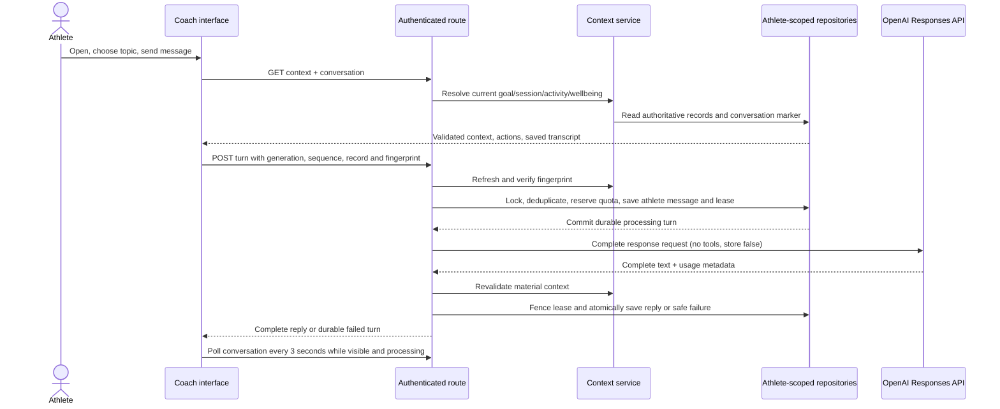

# V2 First Iteration Architecture — Reflect and Prepare

Date: 22 October 2026\
Status: Recovered on `work`; preview Coach migration and integrated release validation remain\
Product scope: [V2 first iteration](../product/V2_FIRST_ITERATION.md)\
Approved interface: [AI Companion design handoff](V2_AI_COMPANION_DESIGN_HANDOFF.md)\
Decision record: [ADR 0010](../adr/0010-v2-conversation-led-coach.md)

## Outcome

The first V2 release keeps `/dashboard` as the landing page and serves the complete conversation-led Coach experience separately at `/dashboard/coach` on the authenticated online site. Home presents the approved goal and scenic running journey, all achieved and upcoming milestones, and a Talk to Orbit link when Coach UI is available. It has no daily check-in, workout, latest-activity, plan, or milestone-management sections. ORBIT offers a deterministic opening based on the latest activity or next effective session, answers free-text questions through the existing server-side OpenAI integration, and retains a single athlete conversation until the athlete clears it. Calendar, activity detail, Readiness, race plan, and Settings remain separate destinations. The interface preserves Coach topic, selected record, draft, and transcript position across Coach re-entry and training-detail returns.

The same minimal Home remains available in local mode; Coach navigation, launcher, and direct route are unavailable there. Chat is not exposed to device/internal credentials, does not publish conversation data to sync or Second Brain, and has no structured training mutation tools.

## Confirmed implementation decisions

- Runtime: authenticated online Coach first; `/dashboard` remains Home in local and online modes. Local mode omits the Coach link and returns direct Coach entry to Home.
- Provider: existing OpenAI integration through a server-only Responses API adapter.
- Model default: `gpt-5-mini`, low reasoning effort, `store: false`, no tools, complete text replies, 3,000 output-token ceiling.
- Conversation: one ongoing conversation per athlete; history is kept until explicit deletion in Settings.
- Release switches: `RACEPREDICTOR_COACH_UI_ENABLED=false` and `RACEPREDICTOR_COACH_CHAT_ENABLED=false` by default. The former gates Coach navigation, Home launcher, and `/dashboard/coach` in online mode; the latter independently gates generation while history reads/deletion remain available.
- OpenAI key absence disables sending in the UI; a generation request that has already been accepted is durably marked failed with a safe recovery state.
- Model output is plain text. The application builds all URLs and actions from validated current training references.

## Component boundaries

| Layer | Implemented responsibility |
| --- | --- |
| `packages/core` | Strict Coach DTOs, message/request schemas, and the framework-independent effective next-session resolver. |
| `apps/web` client | Responsive Coach layout, transcript/composer, topic and record selection, session-scoped draft, pending/retry states, optional wellbeing form, and contextual return state. No DB access. |
| `apps/web` routes/services | Authenticated owner-session boundary, same-origin mutation checks, 32 KiB body bound, API envelopes, context assembly/fingerprints, provider calls and failure handling. |
| `packages/db` | Athlete-scoped conversation/message/turn/usage repositories and atomic lifecycle/concurrency operations. |
| Existing services | Approved plan/goal, effective session, activity facts, current published review, wellbeing, Calendar, Readiness and activity detail. |

The existing Today UI and Coach context both call `resolveCoachUpNext`; UI components do not independently infer whether an activity completed a session. Display advancement never records adherence or completion.

## Request flow

No database transaction is held during provider generation. A repeated client turn identity with identical content replays the existing result; changed content conflicts. Only one live turn is allowed per conversation. The 90-second lease, 60-second provider timeout and request fencing prevent late replies from being published after a retry or history clear. A lost response is reconciled from conversation state.

## Context and opening policy

The server assembles the active approved plan identity/version/hash, linked goal, effective selected session/revision/purpose/prescription/cautions, latest activity by occurrence time, a current published review with provenance/limitations, today's saved wellbeing answers, and at most ten activity summaries from 28 days. The provider receives only this structured allow-list and the last twenty completed messages. GPS routes, raw provider bodies, credentials, private Second Brain content, and unrelated records are excluded.

Saved plan timezone is used, falling back to `Africa/Johannesburg`. A semantic SHA-256 fingerprint includes the local date, source states, relevant identities/revisions and selected context, but not fetch timestamps. It is refreshed on entry/focus/return/date rollover and immediately before generation; a changed fingerprint prevents publication of stale advice.

The initial Coach opening is local and deterministic: explicit recovery state first; otherwise an unreflected latest activity; otherwise next effective training or prescribed recovery; otherwise general guidance. Same-day ambiguity asks the athlete to choose. The user message only advances the reflection marker when explicitly sent with a reflection topic and selected activity; no journal entry or workout association is created.

## Persistence and API

The additive migration adds `CoachConversation`, `CoachTurn`, `CoachMessage`, and `CoachUsageBucket`. Athlete identity participates in repository predicates and relational constraints. The database enforces sequence uniqueness, one assistant response per turn, client-turn idempotency per generation, bounded topic/state values, and separate athlete usage buckets. Snapshots are retained with turns until clear-history; chat tables are absent from sync and Second Brain relations.

All routes use `private, no-store`, strict core Zod contracts, and the existing envelope:

| Route | Result |
| --- | --- |
| `GET /api/v1/coaching/chat/context` | Current context, source state, deterministic opening, fingerprint, and application-built action references. |
| `GET /api/v1/coaching/chat/conversation?before={sequence}` | Latest forty messages, generation/sequence, pagination state, and current turn. |
| `POST /api/v1/coaching/chat/turns` | Persist one athlete message and request its complete reply. |
| `POST /api/v1/coaching/chat/turns/{turnId}/retry` | Retry the latest failed/expired turn with an expected attempt and new retry identity. |
| `DELETE /api/v1/coaching/chat/conversation` | Clear chat content and reflection markers transactionally, increment generation, retain content-free usage buckets. |

Athlete messages are limited to 4,000 characters, replies to 8,000, request bodies to 32 KiB, and assembled prompts to 48 KiB. Prompt trimming removes oldest prior messages first; essential selected-session cautions remain intact. Default quotas are six attempts/minute and sixty/UTC day per athlete, counting explicit retries. Failures and logs retain safe codes and provider metadata but not message/prompt text.

## Interface and continuity

The dark RacePredictor shell contains a minimal Home and a separate Coach destination. Home shows the approved goal/date and scenic artwork, the complete read-only milestone journey, and revised full-body ORBIT artwork as the Talk to Orbit entry. Home has no daily check-in, View plan, Manage milestones, Today, latest activity, or chat composer. Coach, Calendar, and Readiness are primary navigation; Settings is secondary. ORBIT's Coach avatar falls back to an initials mark. Topic choice and selected record remain explicit. The existing wellbeing form is mounted only after the athlete opens the optional check-in in Coach.

Coach-to-record navigation creates an opaque, two-hour recovery context in tab-local session storage. It carries topic, record identity, transcript anchor/scroll position and focus information; message text never enters the URL. Ordinary links and modifier-clicks retain the recovery link. The activity, calendar and plan views can return to Coach; the client refreshes current training facts and transcript on return.

Drafts are held in `sessionStorage` scoped by athlete. Logout clears Coach keys when the client next observes the unauthenticated session; successful history deletion clears the keys and notifies another Coach tab. The conversation itself is server-persisted and does not depend on browser storage.

## Rollout and rollback

1. Use the isolated Neon branch configured for Vercel Preview / Git branch `work`. The application validates and uses `RACEPREDICTOR_V2_DATABASE_URL` and `RACEPREDICTOR_V2_DATABASE_URL_UNPOOLED`, preserving the isolation fix in `bb513f12997de123018165b0b93b468b52b2703f`. Standard integration-injected database variables are not authoritative for this preview. Vercel Preview builds skip migrations.
2. Deploy static avatar derivatives and configure `OPENAI_API_KEY`, `RACEPREDICTOR_COACH_MODEL`, and both false-by-default feature flags.
3. Run automated tests with an injected provider; use synthetic training data for one deliberately bounded live preview smoke test.
4. Enable the UI for the online owner, then enable generation separately. Observe content-free latency, failures, lease expiry, duplicate suppression, context conflicts, quotas and usage.
5. Roll back the Home/Coach presentation change with a targeted code revert. Feature switches can independently hide Coach entry or pause generation. Retain chat schema/history; do not reset the database.

## Home and Coach destination amendment — 25 October 2026

The product owner superseded the earlier Coach-as-landing-page composition. `/dashboard` remains Home; the complete Coach chat mounts at `/dashboard/coach`. Coach UI availability is exposed to the shared navigation and Home as one server-derived boolean: it is true only in online mode when `RACEPREDICTOR_COACH_UI_ENABLED` is true. Direct Coach entry redirects Home when unavailable. `RACEPREDICTOR_COACH_CHAT_ENABLED` continues to gate message generation independently.

Home is limited to the existing greeting/date, approved goal/target/date and scenic background, the full read-only milestone journey, and the accessible Talk to Orbit launcher. Settings remains the location for milestone management. Coach retains the existing chat persistence, optional wellbeing form, routes, API contracts, and recovery continuity. Valid legacy Coach recovery records at `/dashboard` are normalized to `/dashboard/coach` without changing their recovery IDs or presentation state. No schema migration or recovery backfill is needed.

## Historical release environment check — 23 October 2026

The Vercel project `racepedictor` has no custom staging environment. Its single `DATABASE_URL` and `DATABASE_URL_UNPOOLED` entries target both Preview and Production, so a normal Preview build would use the same database as Production. `OPENAI_API_KEY` is configured for Production only. The Neon project-connector lookup returned a 404, and no custom Vercel environments are configured. No Vercel environment values were decrypted or displayed, and no external database or provider operation was run.

This check predates the isolated infrastructure subsequently configured by the owner. Its shared-variable finding must not be used to override the dedicated V2 connection variables added in `bb513f1`. The Vercel build scripts skip migrations for Preview. Production builds retain the existing migration step; production deployment is outside this recovery task.

## Recovery and verification — 25 October 2026

The original local implementation, product/design documents, approved artwork, and migration were present and preserved in recovery stash `19bb7c8cb19643f72ad4bc0461e3a648640a0fda`. Local `work` was fast-forwarded to remote `bb513f1`, then the recovered changes were reapplied without conflicts. All four files introduced by the two preview-infrastructure commits remain unchanged. The explicit cloud test command now includes `preview-database-configuration.test.js` alongside the Coach repository tests.

Provider review fixed timeout coverage through response-body consumption, rejected failed/missing completion statuses and malformed output shapes, and retained all text parts. Synthetic provider tests exercise those cases without live requests.

Current checks:

- Combined gate: `RACEPREDICTOR_CLOUD_MODE=disabled npm run test:cloud` passes with executor permissions: 126 core tests, 89 database tests, 177 web tests, and the web TypeScript/lint gate (392 tests total).
- Core: all 126 tests across 22 files pass.
- Web: all 177 tests across 45 files pass with `RACEPREDICTOR_CLOUD_MODE=disabled`; tests that verify authentication enable cloud mode explicitly. The first unisolated run inherited cloud mode and returned 401 in four existing local-route tests; the isolated run resolves those failures.
- Database: all 89 tests across 19 files pass, including all-migration replay on populated PGlite fixtures, Coach tenant/uniqueness constraints, repository lifecycle tests, and the preserved preview-isolation tests. The initial sandboxed run lost captured child-process stderr in an existing CLI test; rerunning with executor permissions resolves that failure without changing the test.
- Web typecheck, Prisma schema validation, and `VERCEL_ENV=preview npm run vercel-build --workspace @racepredictor/web` pass. The build generates Prisma Client and compiles Next.js without applying migrations.
- Coach Chromium browser suite: 2/2 pass, including reflection display/send, reload/draft restoration, exact activity navigation and return, failed-reply retry without duplicate athlete messages, 320 px reflow, a 640 CSS-pixel layout check, and axe accessibility audit. These are synthetic browser journeys with intercepted chat APIs; they do not establish browser-to-database/provider integration.

### Required chat migration

`packages/db/prisma/migrations/20261022120000_v2_coach_conversations/migration.sql` adds `coach_conversations`, `coach_turns`, `coach_messages`, and `coach_usage_buckets` with athlete-scoped constraints. No training-data backfill is required. Confirm the isolated database's existing schema and Prisma migration ledger before applying it; a schema-only branch may need its already-present migrations baselined rather than replayed.

Prisma CLI does not use the application datasource override. Only inside the verified Preview / `work` environment, validate the dedicated connection pair with `readPreviewDatabaseOverride`, then map `DATABASE_URL` to `RACEPREDICTOR_V2_DATABASE_URL` and `DATABASE_URL_UNPOOLED` to `RACEPREDICTOR_V2_DATABASE_URL_UNPOOLED` for migration status/deploy commands. Do not use integration-injected defaults. This recovery task does not execute those commands against a remote database.

### Remaining release evidence

- Verify the migration ledger and apply the pending Coach migration to the isolated preview.
- Exercise authenticated deployed Coach routes with synthetic activity/approved-session data, real persistence/reload, follow-up messages, retries/lost-response reconciliation, history deletion during generation, and record-return continuity. Existing repository tests use a transaction-capable fake; concurrent Prisma operations need real isolated Postgres coverage.
- Replay correction: new-turn and retry routes now look up a saved result under an athlete/conversation-generation lock before resolving fresh context. Original content/fingerprint hashes must still match; altered payloads conflict. Cleared history and other athletes cannot replay a result. Focused route/repository regression checks pass; the preview release script additionally exercises this against real Postgres.
- Run one bounded request through the actual Coach adapter/model in Preview. The preserved `scripts/verify-v2-preview.cjs` is a separate empty-database/owner/connectivity health smoke and expects zero activities; it does not exercise Coach turns or the Coach model settings. Run it before introducing synthetic training records if still needed.
- Complete actual 200% browser zoom, mobile keyboard/composer, image fallback, long transcript/no-forced-scroll, and owner-authenticated Calendar/Plan/Readiness regression coverage. Prior browser runs found an obsolete goal fixture expectation, an interrupted alternate-host OAuth navigation, and a legacy F08 upload-initiation mock gap; those broader suites were not rerun during recovery.

Both Coach switches remain false by default: `RACEPREDICTOR_COACH_UI_ENABLED` and `RACEPREDICTOR_COACH_CHAT_ENABLED`. Infrastructure provisioning is reported complete by the owner; live configuration and provider/database health are not re-certified by these local checks. No Production deployment, external database write, or live provider call is performed as part of this source recovery.

### Preview release follow-through — 25 October 2026

The subsequent release work configures both Coach switches and `RACEPREDICTOR_COACH_MODEL=gpt-5-mini` for Preview Git branch `work` only. The existing dedicated V2 database variables and isolation guard are retained.

The local regression gate passes 395 tests (126 core, 90 database, 179 web) plus TypeScript/lint. Four Coach browser journeys pass: original reflection/navigation and retry journeys, long-history reading position and image fallback, keyboard-sized mobile viewport reflow, and genuine Chromium browser zoom at 200% (browser zoom setting 2.0, measured devicePixelRatio 2 and 640 CSS pixels from a 1280-pixel viewport). The mobile viewport check does not certify a native phone keyboard.

`scripts/migrate-v2-preview.cjs` validates the dedicated endpoint pair before mapping it into the Prisma CLI environment, runs migration status/deploy, and compares checked-in migration checksums with the isolated database ledger. The schema-only source baseline includes two inherited milestone ledger entries whose migration files are absent from this checkout; those records are retained rather than deleted or rewritten.

`scripts/verify-v2-coach-preview.ts` is a guarded, explicit release check. It uses a randomly named synthetic athlete/activity, the actual application composition and Coach adapter, two bounded live OpenAI turns, persisted reload, duplicate replay after context changes, explicit failure/retry, real Postgres competing claims, and late-result fencing after history clear. It removes only its own fixture records. It tests the server route-handler/data/provider path; a real owner browser conversation is still required to validate the deployed HTTP authentication boundary.
