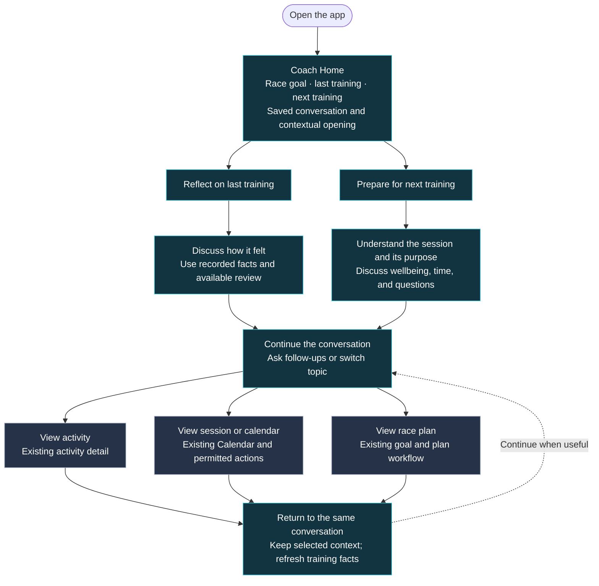
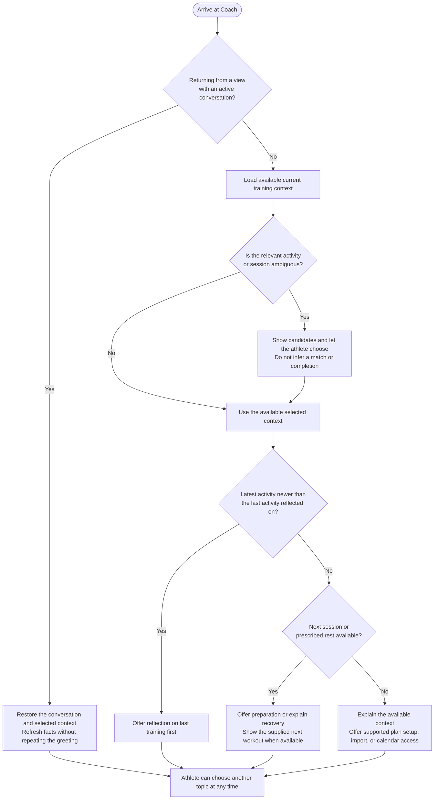
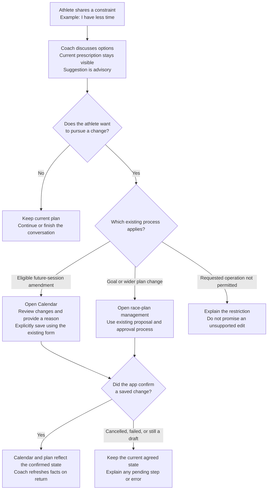

# V2 First Iteration: Product Flow Diagrams

Date: 22 October 2026\
Status: Visual description of the agreed product approach; application changes are not implemented.\
References: [V2 product design](V2_PRODUCT_DESIGN.md) · [First-iteration scope](V2_FIRST_ITERATION.md)

## How to use these diagrams

The first diagram shows the athlete's experience. The second explains how the opening topic is chosen. The third distinguishes advice from a saved training change. These describe the existing first-iteration scope without adding new features.

Mermaid diagrams render in supported Markdown previews, including GitHub. The overview also has a [PNG preview](diagrams/V2_FIRST_ITERATION_FLOW.png), generated from its editable [Graphviz source](diagrams/V2_FIRST_ITERATION_FLOW.dot).

FigJam is suitable for collaborative review of this flow. A clickable Figma prototype would be the subsequent design artifact for experiencing screen layouts, buttons, and transitions. Neither is required to read or maintain this repository reference.

## 1. Athlete journey: conversation into the existing product

The two branches are conversation modes within one Coach screen, not separate products or compulsory screens. Suggested prompts help the athlete start; free text and changing the subject remain available throughout.

Calendar and Readiness remain directly accessible in navigation. **View race plan** remains available on Coach Home before the athlete sends a message. Direct navigation and existing bookmarks do not require passing through this flow. Returning uses ordinary navigation/Back behaviour; new **Discuss with coach** buttons throughout existing screens remain deferred.

The athlete may finish the visit after reading a useful answer. Opening a detail view or changing the plan is optional.

## 2. Choosing the coach's opening

Ambiguity is resolved before a record-specific claim. This is a clarification step, not another priority for selecting the coaching topic. Missing or failed data affects only the relevant context; useful facts and navigation remain available.

A reflection is answered when the athlete responds about that activity. Opening its detail or importing a record does not count as a reflection. Session selection follows the existing effective-calendar policy and saved timezone. An unanswered scheduled session is not automatically a missed workout.

## 3. From a coaching suggestion to a confirmed change

For example, current-day prescription amendments are outside the existing editing rules. A conversational “yes” cannot bypass those rules. In iteration one, chat has no structured training mutation tools: successful conversation persistence is separate from saving wellbeing, changing a session, confirming completion, or approving a plan.

## 4. What an individual visit feels like

Illustrative dialogue; these are not the athlete's actual records or prescribed sessions.

| Moment | Before the next training | After the last training |
| --- | --- | --- |
| Coach opens | “Your next session is an easy run. Shall we go through it?” | “How did your last run feel compared with what you expected?” |
| Athlete replies | “Why is this session easy?” | “The final part felt harder.” |
| Coach follows up | Explains the supplied purpose in the plan and answers further questions. | Asks a focused follow-up and gives a supported takeaway using available facts. |
| Athlete inspects | **View session** opens the correct Calendar session. | **View activity** opens the recorded session and available review. |
| Athlete returns | Same conversation, selected session retained. | Same conversation, selected activity retained. |
| Useful outcome | Understand what to do and why. | Understand the last session and what to consider next. |

The same Home layout supports both visits. A clickable prototype can subsequently demonstrate this sequence: **Coach Home → conversation → existing detail view → return to the saved conversation**.
