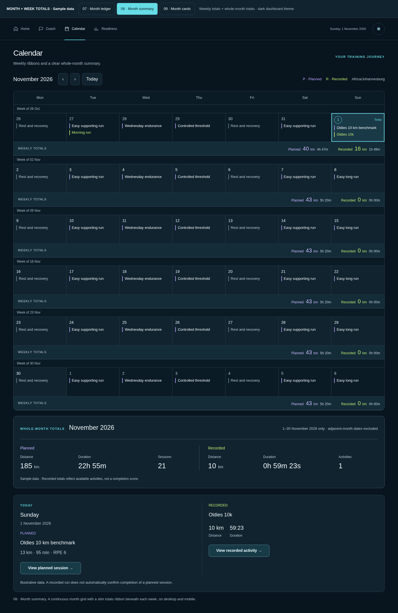
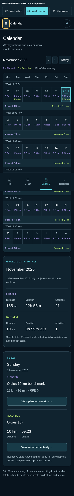

# Calendar Month Summary — Business Requirements Document

1 November 2026 · Version 1.0 · Product Owner draft · Ready for architecture planning

**Selected direction: option 08 · Month summary.** The owner selected this design after reviewing desktop and mobile alternatives. The composition is selected; this BRD is the requested draft for architect review, not a claim of production delivery. The architect must produce a traceable architecture and implementation plan before application changes begin.

## 1. Business outcome

Give the athlete one cohesive application: Calendar must feel like the recently redesigned Home dashboard, with the same dark palette, application font, menus and controls. Calendar must answer three questions without opening a totals disclosure: **What is planned or recorded on each date? What are the totals for each week? What are the totals for the selected month?**

The primary user is the authenticated athlete, initially the owner. The experience must work on desktop and mobile, preserve the complete Monday–Sunday month view, and keep approved prescriptions separate from recorded facts. Success means the athlete can identify a day, its weekly context and the month's totals; open the correct underlying record; return without losing context; and move between Home and Calendar without a visual change of application.

## 2. Selected visuals and their authority

- [Selected interactive prototype](../../design/calendar-theme-round-3/index.html?option=2) — the internal selector value `2` displays named **option 08**.
- [Packaged desktop visual](assets/option-08-desktop.png).
- [Packaged mobile visual](assets/option-08-mobile.png).
- [Shared application-theme contract](../../design/APP_THEME_AND_CALENDAR.md).

### Desktop reference



### Mobile reference



The visuals establish the selected hierarchy, dark styling, full-month structure, ribbon placement and monthly summary. Their fixed November 2026 date, titles, distances and durations are **illustrative fixtures**, never instructions to seed or change athlete records. The prototype review banner, option selector, design commentary and explanatory fake dialogs must not ship. Production retains the month picker even though the prototype simplifies the month heading. The screenshot's fixed bottom navigation appears midway down a full-page capture; in use it stays at the viewport bottom and must not prevent access to content.

### Reading order

```text
Shared dashboard navigation / Settings
Calendar heading + concise supporting line
Selected month + Previous / Next / Today + month picker
Planned / Recorded legend + saved timezone
Mon       Tue       Wed       Thu       Fri       Sat       Sun
Week of [Monday]
Seven date cells with planned and recorded summaries
Weekly totals ribbon: Planned | Recorded
[Repeat for every week intersecting the selected month]
Whole-month totals · [Month Year]
  Planned: distance | duration | sessions
  Recorded: distance | duration | activities
Selected-day summary and detail launchers
```

At wide widths the monthly Planned/Recorded groups and selected-day content can sit side by side within their respective sections. On phones they stack in the same reading order. The month and its totals are the main workspace; a permanent right-hand detail sidebar must not narrow the selected option 08 calendar. Selected-day summary sits below the monthly summary.

## 3. Scope and priorities

| ID | Required business outcome |
|---|---|
| CM-01 | Apply option 08's dark full-month composition at `/dashboard/calendar`. |
| CM-02 | Preserve all seven weekday columns and every week intersecting the month at every supported width. |
| CM-03 | Display a totals ribbon directly beneath every weekly row, expanded by default. |
| CM-04 | Display whole-month totals directly beneath the final weekly ribbon, expanded by default. |
| CM-05 | Reuse the Home font, navigation, surfaces and controls through shared theme components. |
| CM-06 | Preserve existing month navigation, saved timezone, date/session links, activity detail, reasoned session changes and authentication boundaries. |
| CM-07 | Keep missing, partial, stale, loading and failed sources honest, independently where possible. |
| CM-08 | Establish reusable theme defaults for remaining application routes and a documented migration sequence. |

**Included:** Calendar composition and styling; shared theme/nav extraction needed for Home/Calendar parity; day summaries; visible weekly/monthly totals; responsive/accessibility behavior; preservation of existing details/actions; migration plan for the rest of the application.

**Excluded:** a week-only replacement, a new calendar provider/integration, event creation or drag-to-reschedule, changing approved training authority, autonomous plan adaptation, a completion/adherence score, new predictions or coaching commentary, charts added solely for decoration, new theme preferences, public sharing, and redesigning the content/workflows of Coach or other routes. Existing supplemental facts such as calories remain accessible in an appropriate existing detail/disclosure, without expanding the selected six-field monthly summary.

The broader goal remains cohesive styling across Coach, Readiness, Settings, Plan, Activities and Data Quality. The architect must include those routes in the shared-theme inventory and sequencing. Calendar is the first migration; passing Calendar does not establish that the rest of the application is done.

## 4. Shared visual and navigation requirements

| Role | Required baseline |
|---|---|
| Canvas | Explicit dark navy `#08141e`; no white/light calendar surfaces. |
| Panels/cells | Dark `#10232f`; ribbons use a restrained darker/lighter navy variant. |
| Borders | Blue-grey `#293f4d`, strengthened as needed for accessible boundaries. |
| Primary/supporting text | `#f3f8fb` / `#a9bfcb`; validate contrast on every surface. |
| Application typography | `Arial, sans-serif`, inherited consistently in headings, menus, cells, controls and dialogs. |
| Hero typography | Existing condensed Race font stays confined to Home's race hero. |
| Selection / recorded | Pale cyan `#65dce6` / lime `#c2ee72`, with explicit text/state semantics. |
| Planned | Existing violet semantic; preview uses `#bba3ff`. Architect validates contrast and maps to a shared token. |
| Focus | Visible keyboard focus consistent with Home; preview uses `#f5c86b`. |
| Shape / spacing | Matte panels, subtle 1px borders, approximately 12px corners; existing 4px spacing rhythm. |

Use semantic shared tokens and reusable variants. Do not copy the complete Home CSS into Calendar, globally broaden Home hero selectors, or introduce a Calendar-only application font. Keep detailed prose at approximately 16px and supporting facts at 14px; compact date summaries may be smaller if the complete label/detail stays accessible. Do not shrink essential descriptions to force a full month into one viewport.

Desktop navigation matches Home: **Home → Coach (when available) → Calendar → Readiness**, Settings as the utility destination. Mobile uses the same header/menu and bottom navigation treatment. Calendar is selected only on Calendar; shared route matching must handle Home and secondary routes correctly. Preserve Coach feature gating and secondary access to Plan, Activities and Data Quality. The Home screenshot's omitted large logo must not be replaced by Calendar's old sidebar brand block.

The theme must persist across in-app navigation, reload, direct entry and existing dialogs. It is the application's code-level default, not a user preference requiring localStorage or a new database field. Respect the current milestone-Home feature flag and legacy path; extracting shared chrome must not silently activate unrelated Home functionality.

## 5. Calendar and navigation behavior

### 5.1 Month frame

- Default to the current local month in the saved calendar timezone after resolving it. A valid explicit date link selects its containing month/date; a session link focuses that exact session through the existing route contract.
- Retain Previous month, month/year picker, Next month and Today with accessible names. Today selects the actual saved-timezone date, not the prototype's fixed date.
- Render Monday through Sunday and every intersecting week: naturally four, five or six rows as required. Adjacent-month dates remain visible and visually quieter without losing contrast. Each row has a Week of [Monday date] label.
- Show the selected month/year prominently, and the saved timezone near the controls. Saved timezone, not device locale alone, governs date boundaries and Today. Refresh Today at local midnight/resume without dragging the user back from a browsed month.
- Keep selected date and today separate: selection border/state, Today marker/full accessible label. Month navigation updates the frame, totals and announcements consistently. If the old day is outside the new frame, select the first day of the new month; Today selects today. Do not automatically open a day dialog after ordinary month navigation.
- Prevent stale responses from an earlier month overwriting a later selection. Never show a new month heading over the old month's unlabeled totals. Preserve usable prior content during refresh with its correct month/age identified.

### 5.2 Date cells and multiple records

Wide cells show concise planned and recorded summaries independently, preserving full information through named detail launchers. Rest is explicit where prescribed; unscheduled is not an error. Compact cells show date plus P/R metric summaries using existing distance/duration/N/A formatting and an accurate additional-record count. Planned and recorded entries must not replace each other. All records remain reachable; do not assume one run or one session per day.

Date selection uses the bottom selected-day summary at all widths. On compact screens, retain the existing date-specific Day details dialog on day activation so the athlete does not need to scroll through the whole month to read a workout. Keep the bottom summary as persistent selected-date context. Wide-screen date selection updates that summary without forcing scroll/focus away from the cell; a named details action can move to or open full detail. This deliberately replaces the old wide right-hand sidebar while preserving full detail access. Use the current compact boundary of below 1200px unless architecture demonstrates a better synchronized CSS/interaction breakpoint.

Recorded-activity launchers open the existing full-viewport Activity detail directly; selecting the date opens day context. A launcher inside Day details returns to that dialog's record context. Full prescriptions, cautions, original approved source, amendments, historical comparisons and supported actions remain available. Do not replace them with the prototype's explanatory dialogs.

### 5.3 Existing changes and return behavior

Preserve future-session amend/reschedule/skip/restore and supported past-skip rules, required reasons, warning/confirmation behavior, authoritative server checks and revision-conflict recovery. Today does not gain new editing rights. Viewing a date, totals or activity performs no write. After an authorized successful change/import, affected cells and totals refresh together; on failure retain verified data and explain recovery. Reusing an approved overlay never edits the immutable prescription.

Closing details or navigating Back restores the month, selected date, scroll and appropriate launcher focus. Date/session deep links and browser Back/Forward remain usable. Handle missing/deleted/retired targets honestly; never open a different record merely because it shares a date.

## 6. Weekly and monthly totals contract

### 6.1 Eligibility and measurement

Planned aggregates include effective **running sessions** from the active approved plan only, placed by effective local date. Exclude skipped/cancelled sessions, rest, non-running sessions, drafts, retired plans and superseded duplicate versions. Count each eligible session identity once. A reschedule contributes at its effective date only, with original prescription/history preserved in detail. A race represented as a running session counts once; a milestone event by itself contributes nothing. Count a planned run even when its distance is unspecified; its duration/count can still be known.

Recorded aggregates include eligible canonical **running activities** once by stable identity and saved local activity date, not import timestamp. Preserve the product's supported run classification; the architect must verify Calendar's feed scope rather than assuming all returned sports are runs. Exclude deleted/duplicate/ineligible records under existing domain rules. Distinct genuine runs on one date each contribute. Reimported/linked copies must not be double-counted. Use measured recorded distance and elapsed duration; do not substitute moving time, pace-derived time or a planned target. Linking planned and recorded entries does not merge the two aggregates or cancel the prescription.

Planned duration uses the effective prescribed duration, converting stored minutes to a consistent base unit. Sum numeric source values before formatting. Never parse UI labels, estimate distance from pace/time, choose an arbitrary midpoint of a target range, or fill missing metrics with zero. Use existing unit preferences and formatters where supported; current visual reference is kilometres. Retain enough precision that small positive values do not appear as zero; a consistently labeled small-distance fallback is acceptable. Duration formatting must retain meaningful elapsed seconds where available and use a consistent hours/minutes convention.

### 6.2 Weekly ribbons

Each ribbon is directly beneath its own seven dates, in normal reading order, with explicit **Planned** and **Recorded** labels. At wide widths show each category's distance and duration. Counts may be available in its accessible full summary without crowding the ribbon. On phones distance for both categories stays visible; an accessible Weekly totals disclosure/control exposes duration, counts, full date range and completeness. The visible distance totals themselves must not be hidden in a closed disclosure. Do not add a second competing right-hand totals column.

A week covers the complete displayed Monday–Sunday interval, inclusive, including adjacent-month dates. Fetch/aggregate the full interval; do not label month-only data a full-week total. Show the date range in the full accessible summary. When a boundary week crosses a year, include years where needed to avoid ambiguity.

### 6.3 Whole-month summary

Place one full-width summary directly beneath the final weekly ribbon and above selected-day details. Heading: **Whole-month totals · [Month Year]**, with the included date range. Planned and Recorded have equal, distinct labeled groups:

| Planned | Recorded |
|---|---|
| Total distance | Total distance |
| Total duration | Total elapsed duration |
| Number of running sessions | Number of running activities |

These six facts remain visible without a disclosure on desktop and phone; groups stack Planned first on phone. Counts label their category; do not call a recorded activity a completed planned session. This is full-month planned volume versus currently available recorded facts, not a month-to-date plan comparison or progress percentage.

Calculate month totals independently using the first through last local dates of that month. **Do not sum full weekly totals:** boundary weeks include other months. Do not double-count records shared between displayed ranges. Counts must use the same eligibility/date rules as distances. The heading, range and figures update when changing months.

### 6.4 Zero, incomplete and unavailable

| Condition | Required presentation |
|---|---|
| Successful complete source; no eligible runs in period | Zero distance, duration and count are legitimate; distinguish no runs from loading/failure. |
| No active approved plan | Say No active plan; do not label fabricated planned zeroes as a known approved schedule. Recorded totals remain usable. |
| One eligible run has unknown distance but known duration | Count the run and known duration; label distance Incomplete, with a known subtotal and missing-count explanation in details, or unavailable if no subtotal exists. |
| All values for a metric unknown | Unavailable/N/A with explanation; never zero. |
| Recorded feed unavailable | Recorded totals/count unavailable; no false 0 km/0 runs. Preserve independently verified planned content. |
| Some range pages/records not loaded | Aggregate is incomplete until all eligible records are fetched; no first-page total presented as complete. |
| Stale/refreshing | Retain correctly dated prior figures with a stale/updating label; do not imply freshness or a new-month total. |
| Rest-only approved range | Zero running volume is valid, with Rest/no running sessions context. |

If source contracts cannot represent completeness, the architecture must identify the gap and propose the smallest additive solution. Domain API, privacy and schema approvals remain in force; this BRD does not mandate a new endpoint or persistence layer.

### 6.5 Fixture example for architect/QA

The packaged November 2026 visual fixture has: first displayed week, 26 October–1 November, **40 planned km / 4h 47m**, **16 recorded km / 1h 49m 19s**. Its recorded figures comprise the 6 km October 27 run plus the 10 km November 1 run. The whole November summary is **185 planned km / 22h 55m / 21 sessions** and **10 recorded km / 59m 23s / 1 activity**. October's run contributes to that week but not November. Displayed weekly minutes may omit seconds, while raw aggregation retains them. These values are a controlled fixture, not acceptance values for the owner's real records.

## 7. Responsive and accessibility requirements

- Review 320, 390, 768, 1024 and 1440 CSS-pixel widths, short landscape heights and 200% zoom. No page-level horizontal overflow or clipped totals/actions. Natural vertical scrolling is allowed; all six rows need not fit one screen.
- Keep seven weekday/date columns on phones. With 16px page gutters a 320px viewport leaves only 288px; give the calendar approximately 6px side insets so seven 44px date targets fit. Include borders in this calculation. Other content retains readable gutters. Do not solve it by shrinking touch targets.
- Match Home's wide container/top menu, progressively reducing gutters; the reference uses an approximately 1500px outer max width including 48px wide gutters. Use one shared scale rather than per-route geometry.
- Weekly distance ribbons wrap/reflow as needed while retaining both categories. Monthly duration and counts must not disappear on phones. Detailed text/actions remain comfortably readable.
- Fixed mobile navigation respects safe areas and bottom padding. Last summary/detail action can scroll fully clear of it. No forced page scroll when merely selecting a date.
- Meet WCAG 2.2 AA: text contrast, landmarks, one H1, logical headings/reading order, full date/weekday accessible names, visible focus, keyboard operation, 44px targets and status conveyed beyond colour. Avoid nested interactive elements in date cells.
- Preserve keyboard month navigation and date operation; if ARIA grid semantics are used, implement the complete keyboard model. Otherwise prefer correctly labeled native controls over an incomplete grid role.
- Announce month changes/meaningful errors politely without reannouncing unchanged totals on polling. Dialogs manage focus, Escape, inert background and return focus. Reduced motion and forced colours remain usable.

## 8. Loading, recovery and performance

Reserve stable calendar/totals structure while loading; never flash zero/empty totals before source resolution. Keep unrelated route navigation usable. Source-specific failures are labeled where feasible; verify whether the existing loader currently couples schedule and activity loading, and plan any required improvement rather than claiming isolation already exists. Failed activity detail must not erase approved calendar data. Retry is scoped and does not repeat a mutation.

Load the full displayed date frame and complete aggregate source sets using bounded requests. A totals ribbon must not trigger seven additional detail requests, and aggregate computation must not fetch each full activity record. Opening full detail remains lazy. Avoid reloading the entire application shell during date selection. Do not introduce persisted aggregate snapshots unless architecture justifies their authority, invalidation, completeness and rollback costs.

## 9. Existing code and constraints for architecture investigation

These are verified entry points, not a prescribed final component tree:

| Area | Current repository location / observation |
|---|---|
| Calendar route | `apps/web/app/dashboard/calendar/page.tsx`; passes `date` and `session` into CalendarPage. |
| Calendar composition / totals | `apps/web/components/coaching/coaching-pages.tsx`; `CalendarPage`, `weekTotals` and `monthTotals` exist; totals currently live in a collapsed Training totals and timezone disclosure; desktop uses a selected-day sidebar. |
| Date summaries / metric fallback | `apps/web/components/coaching/calendar-day-summary.tsx`, `apps/web/lib/calendar-display.ts`. |
| UI data views | `apps/web/lib/coaching-ui-state.ts`; session effective/original dates, kind, status, revision and amendment fields; activities have localDate, distance and elapsed duration. |
| Calendar read | Existing `/api/v1/coaching/calendar?from=...&to=...`; inspect actual schedule and activity request completeness and response provenance. |
| Current Home styling | `apps/web/components/dashboard/option-nine-reference.css`, `option-nine-home.css`, `option-nine-home.tsx`; navigation is currently Home-local with hardcoded Home active. Generated reference CSS must not be edited without its generation contract. |
| Reusable navigation / theme | `dashboard-navigation.tsx`, `dashboard-navigation-state.ts`, `app/globals.css`, `app/dashboard/layout.tsx`; older rail/Inter styles and feature context must be reconciled. |

Do not duplicate existing totals or assume their current missing-data behavior satisfies this BRD. In particular, verify no-plan vs complete-empty, actual feed eligibility, complete boundary-week loading, unavailable activity totals, source revision consistency and missing planned distance. Preserve local/online execution modes and athlete-scoped authorization. Do not inspect/change private athlete records to complete the architecture document.

## 10. Acceptance criteria

| ID | Scenario | Required evidence/result |
|---|---|---|
| AC-01 | Open Calendar at 1440px | Option 08 dark composition; seven headings; full month; ribbon after each week; visible monthly summary before bottom selected-day detail; no right sidebar narrowing the month. |
| AC-02 | Open at 320/390/768/1024px and 200% zoom | All columns retained, both weekly distances visible, all six monthly facts readable, no horizontal overflow/clipped controls; date targets at least 44px including layout borders. |
| AC-03 | Navigate Home → Calendar → Readiness/Settings; reload/direct-link | Consistent shared font/palette/menu; correct active link, Coach gating and feature-flag behavior; no duplicate shell. Remaining migration status is documented honestly. |
| AC-04 | Browse Feb 2021, Feb 2024 and Nov 2026 | Correct four/five/six rows, leap day, month/year labels, adjacent dates and full-week totals. |
| AC-05 | Compare boundary week and month using fixture above | October run counted once in its week and excluded from November; monthly fixture equals specified distance/duration/counts. |
| AC-06 | Rapidly move months / picker / Today; cross local midnight | Latest range wins; totals match header; saved timezone determines dates; browsed month is not unexpectedly reset. |
| AC-07 | Multiple same-day runs/sessions, reimports and genuine duplicates | Distinct canonical records counted once each; additional-record access/counts correct; import time does not choose date. |
| AC-08 | Amend/reschedule/skip/restore a supported session | Existing reason/permission/revision rules preserved; effective date/values and relevant totals update; original prescription/history unchanged. |
| AC-09 | Rest, draft, retired plan, non-run and milestone-only records | Eligibility rules respected; no phantom running volume or plan-completion claim. |
| AC-10 | Missing one distance, missing all distances, no active plan | Metric-specific incomplete/unavailable vs no-plan treatment; known time/count retained without fabricated zero. |
| AC-11 | Successful empty feed vs failed/partial/paginated feed | Zero only for complete empty source; unavailable/incomplete labeled; every page required for full aggregate. |
| AC-12 | Activity feed fails / detail fails / refresh uses cached data | Scope and age of retained facts explicit; planned content remains when independently verified; correct retry; no false success/empty. |
| AC-13 | Select a date, open planned details/direct activity, close/Back | Correct exact record; compact Day dialog retained; bottom summary updates; focus/scroll/month restored; existing source/history/cautions available. |
| AC-14 | Valid/invalid/missing `date` and `session` deep links | Existing routing works, selected month/session correct; invalid/removed target explained with safe fallback; browser history preserved. |
| AC-15 | Use keyboard/screen reader/forced colours/reduced motion | Full dates/labels, logical order, visible focus, modal handling and text state; no nested buttons or keyboard trap. |
| AC-16 | Mobile bottom navigation overlaps viewport content | Every weekly/monthly value and final action can scroll clear of navigation/safe areas. |
| AC-17 | Load totals / navigate dates / open read-only details | No writes, no per-record aggregate fetch waterfall, existing athlete authorization maintained. |
| AC-18 | Compare selected reference against implementation | No review controls/fake dialogs/sample seeding; month picker preserved; aggregate units/rounding consistent; production styling matches screenshot intent. |

Automated preview checks from the design phase passed 15 viewport/variant cases. They cover sample layouts/interactions and a fixture total, **not** production integration, all acceptance cases, native zoom, source permissions or complete accessibility compliance. Implementation must produce new evidence mapped to AC-01–18.

## 11. Required architect deliverables

Return a plan that includes:

1. **Requirements traceability:** map CM-01–08 and AC-01–18 to components, data flows, tests and delivery slices. Identify any requirement gap explicitly.
2. **Shared visual architecture:** token ownership, safe generated-CSS integration, route/shell ownership, active navigation, feature-flag/legacy paths and migration sequencing for all named routes. Preserve Home's selected composition.
3. **Calendar component and interaction plan:** month frame, weekly ribbons, monthly summary, bottom selected-day summary, compact Day dialog and existing full activity detail. Specify consistent breakpoints, focus/return and browser/deep-link behavior.
4. **Aggregation contract:** eligible record scope, date/timezone boundaries, units/precision, full-frame fetch completeness, immutable/effective source relationships, unknown/zero/unavailable state representation, refresh/concurrency and aggregate reuse. Prefer pure derived totals from existing authoritative data where adequate.
5. **Compatibility assessment:** identify whether current API/data shapes are sufficient; propose only necessary additive changes with contract/schema impacts and existing authorization. No schema change is assumed by the selected UI.
6. **Validation plan:** fixture and domain aggregation tests; actual route/browser checks; viewport/zoom/accessibility evidence; existing Calendar detail/edit and Home/nav regression coverage. Run touched-scope lint/typecheck/tests/build under repository gates.
7. **Delivery and rollback:** staged slices (shared theme → Calendar composition → trustworthy aggregates/states → remaining theme migration), affected routes/flags, release criteria, rollback preserving data and verification of local/online paths. Do not deploy as part of the planning handoff.
8. **Documentation synchronization:** updated implementation plan, architecture/UX records, any justified API/schema changes, progress/roadmap and docs-sync gate. Distinguish completed scope from pending app-wide migration.

### Product decisions settled / technical decisions open

Settled: option 08; dark dashboard identity; consistent Arial/nav; full month and seven weekdays at phone widths; always-visible weekly distances and monthly six-field summary; weekly complete intervals vs month-only totals; planned/recorded separation; summary below calendar; no new training authority.

Open to architecture: component boundaries, source fetch/aggregate placement, narrowly necessary contract changes, exact responsive geometry within acceptance, data completeness representation, cache invalidation and staged feature-flag strategy. Surface material departures from selected behavior for owner review rather than silently simplifying them. This instruction does not require approval for routine technical choices inside the requirements.

## 12. Authority and delivery status

This BRD and the owner's option 08 selection supersede earlier alternative recommendations and pending-selection statements in the historical concept documents. The Home-only exclusion of Calendar in the 31 October Home BRD no longer limits this separately requested work. Domain boundaries remain governed by:

- [Context and delivery constraints](../../CONTEXT.md).
- [UI/UX specification](../../UI_UX_SPEC.md) and [visual guidelines](../../UI_GUIDELINES.md).
- [Design intent contract](../../design/DESIGN_INTENT_CONTRACT.md).
- [Current mobile month behavior](../../plans/CALENDAR_MOBILE_MONTH_IMPLEMENTATION.md).
- [Shared activity detail/split handoff](../../plans/ACTIVITY_SPLIT_COMPARISON.md).
- [Reasoned session editing](../FUTURE_PLAN_SESSION_EDITING.md).
- [Goal update/approval process](../../GOAL_UPDATE_PROCESS.md).
- [Required delivery workflow](../../CODEX_WORKFLOW.md).

At the initial BRD handoff, delivered the draft, packaged selected desktop/mobile visuals, source/prototype links and documentation of the design selection; application implementation was not part of that handoff.

Initial docs-sync recorded the design selection only. The later implementation amendment below also updates ARCHITECTURE, API_CONTRACT, UI_UX_SPEC, UI_GUIDELINES, CONTEXT, the design authority and ROADMAP; no database schema change was needed.

## Implementation amendment — today/week entry positioning (1 November 2026)

On each normal Calendar route entry, including return from another app page or browser Back, select the saved-timezone current date and bring its Monday–Sunday row into view. When the route carries a valid explicit `date`, bring that date's week into view; a `session` deep link keeps its existing exact-session detail behavior. The Today control repeats the reveal. Month navigation does not jump to today, and ordinary scrolling is not intercepted. When a day or activity dialog closes, restore the prior scroll position and focus to its launcher. This amendment supersedes the earlier general scroll restoration sentence in section 5.3 for route exit/return; it does not change detail-dialog return behavior.

## Implementation status — 1 November 2026

Option 08, shared route-aware navigation/theme, additive Calendar status metadata, pure weekly/month aggregation, and Calendar entry positioning are implemented behind `RACEPREDICTOR_CALENDAR_MONTH_SUMMARY_ENABLED`, which defaults off. The flag-enabled responsive grid and positioning passed focused local Playwright checks at 320, 390, 768, 1024, 1440, and short-landscape 844×390; direct session links, Today/month navigation and browser Back were exercised. The production build, typecheck, and full web unit suite passed. Broader acceptance is still required for every named route, 200% zoom, accessibility/forced-colour states, dialog scroll/focus restoration, delayed-load interaction cancellation, and local/cloud preview behavior. No deployment or production activation has occurred. See [the implementation plan and remaining release gates](../../plans/CALENDAR_MONTH_SUMMARY_IMPLEMENTATION.md).
