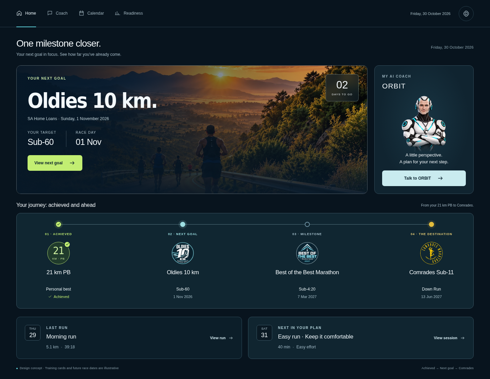
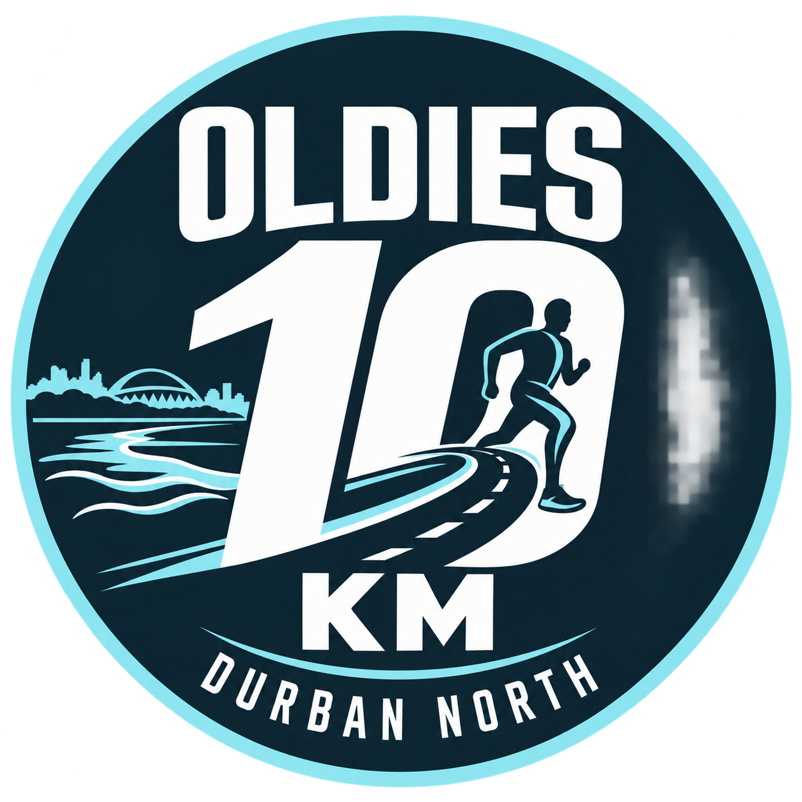
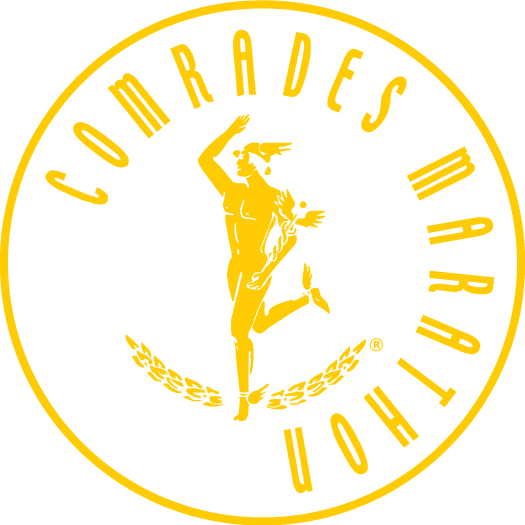

# Milestone-first Home and milestone images — Business Requirements

31 October 2026 · Product Owner requirements · Version 1.0 · Ready for architecture planning

This document defines the requested product behaviour and acceptance criteria. It does not prescribe a technical architecture or authorize production data changes. The architect should use it to prepare an implementation plan before development starts.

## 1. Business outcome and reference

Home should immediately answer: **What is my next goal, how does it lead to Comrades, what have I already achieved, and what was my last run and next planned session?** ORBIT remains visible as the athlete’s AI coach. Settings provides one place to manage the milestone journey and its images.

The selected design is **09 · Last run + next in your plan**, building on the achieved-milestones version. Earlier options are reference history rather than alternative requirements.

- [Published interactive option 09](https://milestone-homepage-preview-oct30.astralharp10.chatgpt.site/?v=6#last-next-training)
- [Local prototype HTML](../../plans/references/milestone-home/09-last-next-training.html)
- [Full desktop image](../../plans/references/milestone-home/09-last-next-training-desktop.png)
- [Full phone image](../../plans/references/milestone-home/09-last-next-training-mobile.png)

The screenshot establishes composition, hierarchy, artwork and labels. Its fixed dates, countdown and workout examples are sample content. Production must use saved, verified athlete data. The comparison-gallery controls, design notes, option selector and explanatory prototype dialogs are not production features.

### Intended users and success

The primary user is the authenticated athlete, initially the product owner. A successful release lets the athlete identify the next goal, final destination, last recorded run and next planned session without opening another screen; open the correct underlying detail from each action; and change a milestone image in Settings and see the saved image on Home after reload. The experience must work on desktop and phone without clipped content or an accidental change to training records.

## 2. Scope and product decisions

| ID | Required outcome for this release |
| --- | --- |
| MH-01 | Replace Home’s main content composition with option 09’s next-goal spotlight, ORBIT panel, achieved-and-ahead journey and paired training summaries. |
| MH-02 | Keep a top-right days-to-go count inside the next-goal spotlight, calculated from the athlete’s saved timezone and event date. |
| MH-03 | Show achieved milestones, including the confirmed 21 km PB, alongside upcoming targets and the final goal, with truthful status and available facts. |
| MH-04 | Display Last run on the left and Next in your plan on the right on desktop, each with a weekday/date tile; stack them in that order on phones. |
| MH-05 | Extend the existing Settings → Milestones section with milestone image selection, upload, preview, replacement and removal. |
| MH-06 | Include the supplied Oldies 10 km, Best of the Best Marathon and Comrades image assets in delivery as the initial image choices. |
| MH-07 | Preserve existing milestone creation, result management, timeline membership and approved-plan controls; use the same saved milestone identity across Home and Settings. |
| MH-08 | Handle missing, stale and unavailable data independently, without fabricated values or loss of otherwise available content. |

**Included:** Home UI and navigation into existing details; responsive timeline; image management for planned milestones, achievements and the final goal; initial race image catalogue; persistence and recovery requirements; integration with existing milestone management.

**Deferred:** generating an image with AI inside the app, an image-design editor, public event search/catalogue, automatic race-logo discovery and social sharing. For now, the athlete can create an image elsewhere and upload it. There must be no inactive “Generate image” control in the delivered UI.

This release does not redesign Coach, Calendar or activity details, introduce a new planning/approval process, infer PBs from unverified data, or change a training prescription through a homepage action. Preserve existing supported navigation and routes. The prototype’s example navigation tabs do not authorize an unrelated navigation restructure. The requested Home presentation omits the application logo; race marks and ORBIT artwork remain. Any change to branding elsewhere needs separate scope.

## 3. Home UI requirements

### 3.1 Structure and visual treatment

Read in this order:

1. Page heading: **One milestone closer.** Supporting line: **Your next goal in focus. See how far you’ve already come.**
2. Next-goal photograph panel with ORBIT beside it on desktop.
3. **Your journey: achieved and ahead** timeline spanning the full content width.
4. Two bordered summary cards: **Last run** and **Next in your plan**.

Retain the option 09 dark navy surfaces, subtle blue-grey borders, rounded panels, pale text and restrained lime/cyan/gold accents. Lime highlights the next-goal action and achieved state; cyan identifies the next goal; gold identifies the final destination. Meaning must also be conveyed by text and icons. Reuse the supplied road photograph and existing ORBIT character; do not replace them with race logos. Milestone images belong to the timeline and their management/details surfaces.

Use readable production type and existing design tokens. Do not shrink text to match a screenshot scaled down in the gallery. Long event names must wrap naturally. Normal vertical page scrolling is allowed; the entire journey and cards need not fit above the fold.

### 3.2 Next-goal spotlight

The wide left panel is the dominant element. It contains:

- **Your next goal** label, large event title and distance, and event subtitle where one exists.
- Full race date, plus concise **Your target** and **Race day** facts.
- **View next goal** action opening the selected saved target’s details.
- A compact countdown at the panel’s upper right, visually separate from the title and action.

The next goal is the earliest eligible, visible intermediate target on or after the athlete’s current local date. Exclude completed, removed and superseded targets. A past target awaiting a result stays marked **Result pending** in the journey; it must not freeze the spotlight on a past race. If no intermediate target remains, show the future/current approved primary goal as **Your final goal**. If no future approved goal exists, show an honest empty state with a link to Plan; do not show an old race as upcoming.

Calculate days using local calendar dates, avoiding rolling 24-hour rounding. Two days may display as **02**; larger counts must not be truncated. On the race date show **Race day**. Never show negative days. If the date is unknown or the verified context is unavailable, show a clear unavailable/date-needed state rather than a computed number.

A target is an aspiration, not a prediction. Do not add an “on track” claim without a separately supported assessment. Full dates must be available even where the compact fact shows only day/month.

### 3.3 ORBIT panel

Keep **My AI Coach**, **ORBIT**, the existing character image, the short two-line message and **Talk to ORBIT** action in a dedicated companion panel. It is narrower than the spotlight and aligns with its top and bottom on wide desktop screens. It remains visible in the normal document flow rather than becoming an overlay.

On phones place a compact ORBIT card directly after the spotlight, as in option 09. The button opens the existing Coach experience. Opening Coach does not send a message, create a proposal or change a plan. Any passed goal context must refer to the current saved target and must not overwrite an unsent conversation draft.

### 3.4 Achieved-and-ahead timeline

The initial visual sequence is **21 km PB → Oldies 10 km → Best of the Best Marathon → Comrades Sub-11**. This is the requested starting presentation, subject to the athlete’s actual saved records and membership choices.

Each stop shows a connector node, a textual role/status label, an image or fallback badge, event/achievement name, target or confirmed result where known, and date where known. The next goal is visually emphasized; Comrades is the final gold destination. The achieved PB uses a checkmark and **Achieved** text. Do not present an upcoming target as a completed result.

On desktop distribute visible stops evenly across the available width, with the final goal at the far-right endpoint. Spacing represents ordered steps, not elapsed time or training progress. On phones use a vertical connected sequence, ending with Comrades. Do not require horizontal swiping to read the four initial milestones.

Preserve all visible saved entries rather than silently limiting the journey to the three example races. With many entries, retain readable spacing through an accessible expanded journey view; the primary Home view must preserve the next target, final endpoint and a clear **View all milestones** action. The architect must define the overflow presentation before implementation. Entries must not overlap or shrink to unreadable text.

Order achievements by known occurrence date, then approved targets chronologically, with the current primary goal as the destination. An achievement with an unknown date can precede upcoming targets but must not receive a guessed position in historical time. Same-date entries use a stable order. Merge target/result representations only through existing verified reconciliation or explicit same-race linking, never matching titles alone.

Provide **Manage milestones** near the journey heading, linking directly to Settings → Milestones. Each milestone also needs a keyboard-accessible details action opening a read-only summary of its saved target/result/image. Existing edit controls stay in Settings. For the final goal, provide access to its approved Plan context. Return from details to the same Home position.

### 3.5 Last run and Next in your plan

These are two equal-width, separate bordered cards below the journey. Each includes a compact square weekday/day tile, uppercase section label, main title, concise metrics and a labelled detail action.

| Card | Content | Action |
| --- | --- | --- |
| Last run | Most recent eligible recorded running activity; activity title; recorded distance and elapsed duration when available; weekday/day from the recorded activity’s local date. | **View run** opens that exact activity in the existing shared activity-detail experience. |
| Next in your plan | Earliest effective scheduled running session on/after today in the active approved plan; title, planned duration or distance and effort guidance where supplied; weekday/day from the session date. | **View session** opens that exact planned session in the existing Calendar/session detail experience. |

For Last run, use the recorded start timestamp for ordering, not import time. Exclude future-dated and deleted activities and non-running records. Preserve the app’s established classification of running activities. Missing metrics remain absent; never borrow a planned value to complete a recorded summary.

For Next in your plan, use effective saved scheduling, including supported reschedules and skip decisions. Exclude skipped/cancelled sessions, retired plans and drafts. An explicitly completed or authoritatively linked session may be excluded; recording an unrelated run is not proof a planned session was completed. If a date has no session time, use the date and stable saved order without inventing a time. Rest days do not replace a running session: label the next run’s actual future date. Unresolved same-day completion must remain truthful in details rather than inferred.

The full date, including month/year, must be accessible and available in the details so a standalone “29” is unambiguous. At smaller desktop widths the action may wrap beneath the content. On phones stack **Last run first**, **Next in your plan second**, retaining the date tiles. Neither card depends on the other having data.

## 4. Settings → Milestones UI

Extend the existing canonical Milestones section, addressable from Home and Settings (currently `section=milestones`). Do not create a competing manager or a new primary navigation destination.

### 4.1 Management overview

Keep the primary approved goal distinct from intermediate targets and achievements. Show existing visible/removed membership, known dates, target/result status and supported actions. Add a thumbnail/fallback and **Manage image** control for each entry, including the primary goal. The initial three race images should be selectable through **Choose existing image** in the image editor.

Retain discoverable **Add milestone**, historical edit, recorded-race assignment/change/unlink, remove/restore, and proposed target-change actions. Labels must distinguish removing an entry from the Home journey from deleting a historical record or changing an approved training plan. Removed entries remain manageable and their images remain available when restored.

### 4.2 Image editor

The editor identifies the selected milestone by name and date/status. It shows the current image or fallback, a preview with the same bounded presentation used on the timeline, and these actions:

- **Choose existing image**: select Oldies, Best of the Best or Comrades from the initial catalogue.
- **Upload image**: pick a local file on desktop or the phone’s supported file/photo picker.
- **Replace image**: prepare a different image while preserving the saved image until Save succeeds.
- **Remove image**: prepare removal of the entry-specific image and preview the default/fallback that will result.
- **Save image** and **Cancel**.

Image selection is a draft until Save. Show upload/saving progress and prevent duplicate submissions. Cancel, Escape and closing the editor do not change the saved milestone. Warn before discarding an unsaved image choice. After successful save, show confirmation and the updated thumbnail; Home must display the same image after navigation/reload and on another authenticated supported device.

A visual-only image change saves independently of plan approval. It must not change a race’s name, target, date, achievement, completion, timeline membership or approved plan. The image is associated with the selected saved identity, not a title string. Renaming or retargeting the same milestone must preserve its selected image. Linking target and achievement records should produce one displayed image; an explicitly chosen entry image takes precedence over a catalogue default. Any conflicting explicit choices require a clear owner choice rather than a silent overwrite.

### 4.3 Upload requirements

V1 accepts **PNG, JPEG and WebP**, up to **5 MB per file**, with dimensions from **64 × 64 to 4096 × 4096 pixels**. These are proposed release limits for architect feasibility review; include the packaged race marks within them. Reject unsupported, corrupt, oversized or out-of-range files with an actionable explanation and preserve the current image.

Preserve aspect ratio and transparency. Centre and contain the image inside the timeline’s mark area, leaving room around it; do not crop race lettering or stretch the mark. A preview should make a dark/light background problem visible before Save. No crop tool is required in V1. Use a stable neutral backdrop if necessary for legibility.

Default accessible image text can use the saved race name (for example, “Oldies 10 km race mark”); allow an optional descriptive label. Avoid duplicate screen-reader announcements when adjacent visible text already conveys the same content. Images must not be the only way to identify a milestone.

Validate the actual uploaded file rather than its extension alone. Do not accept executable/active content or SVG in V1. Strip unnecessary embedded personal metadata from served derivatives. Athlete-owned uploads must follow the application’s authenticated access boundary; no public sharing is added. Architecture owns the storage, processing, ownership checks, limits enforcement and cleanup design.

## 5. Initial content and supplied images

Include these actual files in the implementation asset package, not just remote links or filenames. The copies alongside this BRD are the handoff assets. Reuse the existing road and ORBIT assets separately.

| Entry | Display and target | Date/content status | Initial image |
| --- | --- | --- | --- |
| 21 km PB | **21 km PB**, **Personal best**, **Achieved** | Athlete-confirmed achievement; finish time, date and race identity have not been supplied. Persist only through the existing confirmed achievement flow if no saved record exists. | Existing 21/PB badge with checkmark; do not invent a race logo. Upload may replace its badge later. |
| Oldies 10 km | Durban North, South Africa; **Sub-60** | User-supplied 1 November; prototype year is 2026. Verify against the approved record before using as live target data. | [Oldies mark](assets/oldies-durban-north-logo.png) — original custom concept artwork. |
| Best of the Best Marathon | **Sub-4:20** | Event/year 2027 and target supplied by athlete. **7 March 2027 is an unconfirmed prototype date**; do not seed it as verified. | [Best of the Best mark](assets/best-of-the-best-2027-logo.png) — original custom concept artwork. |
| Comrades Marathon | **Comrades Sub-11**, **Down Run** | Prototype shows 13 June 2027 and 89 km; use verified approved goal values, with owner resolution of any mismatch. | [Comrades emblem](assets/comrades-logo.png) — supplied gold runner emblem. |

Oldies and Best of the Best are usable concept marks, not verified official event logos. The Comrades image was retrieved from a public runner’s repository, not freshly verified with the event organizer. Preserve provenance in delivery documentation and review the appropriate production use; the athlete can replace each via Settings. See [asset provenance](assets/README.md).

Start the image catalogue with all three images. Assign them to the intended verified saved entries during explicit setup or a reviewed identity mapping. Never create duplicate races, overwrite dates/targets, infer achievements, or attach a logo to an unrelated event merely because its distance/title resembles an example. Existing owner uploads override catalogue defaults. Installing this feature must not automatically create an approved plan or change one.

## 6. End-to-end user flows

### A. Daily Home and details

1. Athlete opens Home. Independently load verified goal/journey, recorded-run and effective planned-session content; show scoped loading placeholders.
2. Athlete sees the next target/countdown first, ORBIT beside it, the achieved-and-ahead journey and both training cards below.
3. **View next goal** opens the selected target; a timeline detail opens that selected milestone; **View run** opens the selected recorded activity; **View session** opens the selected planned session.
4. Close/Back returns to the launcher and previous scroll position. These read-only actions do not record completion or change a plan.
5. **Talk to ORBIT** opens Coach. Existing explicit forms and approval processes govern any later structured changes.

### B. Upload or replace a milestone image

1. Home → **Manage milestones** → Settings Milestones, or enter that section directly.
2. Choose **Manage image** on the intended entry, for example Best of the Best Marathon.
3. Choose an existing mark or upload a file; see file validation and a timeline-sized preview.
4. Save explicitly. Keep the old saved image visible until the new choice is acknowledged as saved.
5. Return to Home and see the new mark on that same entry. Reload preserves it. Cancelling instead leaves the original image intact.
6. Removing an entry-specific image returns to its catalogue default where mapped, otherwise the neutral badge; explain this in the confirmation/preview.

### C. Add an achieved milestone

1. Settings → **Add milestone** → **Achieved milestone**.
2. Enter the title and confirmed achievement category; provide only known facts. Optionally select a recorded running activity using existing controls. Do not infer a PB from an upload or activity selection.
3. Confirm the achievement using the existing confirmation flow and save. Image selection can follow on the saved record; make this continuation obvious.
4. The visible journey includes the achievement with its supported status and image/fallback. Unknown time/date remain absent.

### D. Add or change a planned race target

1. Settings → **Add milestone** → **Planned race target**, or propose a change on an existing target.
2. Enter supported title/event, distance, date and owner-supplied target time. Explain missing required fields; do not use prototype values as defaults presented as facts.
3. **Prepare plan update** creates a proposed request. Continue through the existing Plan workflow, complete proposal, owner review/approval and verified publication as applicable.
4. Only the approved and verified target appears as an active Home target. Drafts must not change the spotlight or countdown.
5. On the saved target, use **Manage image**. A default catalogue mark may appear without requiring an image upload. Persisting images on unapproved draft targets is outside V1 scope.

### E. Remove, restore and reconcile

Use existing Settings controls and named confirmations. Removing from the journey preserves approved plan/result facts and the image association. Restoring brings back the selected entry and image. Linking an existing result to a target requires same-race confirmation and supported identity/evidence; it must not award a missed time target. Primary-goal changes continue through Plan. Permanent achievement deletion retains its existing distinct confirmation and does not delete the recorded activity.

## 7. Authority, data and persistence rules

Home and Settings must agree on membership, stable identity, target/result state and selected image. Reuse the current shared milestone projection and removal/link decisions rather than constructing a second journey from raw approved targets. Existing removed entries must not reappear during refresh or fallback.

The active approved plan and verified goal context remain authoritative for targets. Confirmed saved achievements and recorded activities remain authoritative for results. An elapsed race date means **Result pending**, not **Achieved**. Completing a race and meeting its time target are separate facts. A workout summary is not proof of milestone completion.

Preserve the existing immediate remove/restore/link/unlink membership behaviour, historical confirmation and concurrency checks. Planned additions and date/time changes retain full-plan approval/publication. Saving an image is a new presentation capability and needs durable athlete-owned persistence without mutating immutable plan versions. Do not introduce schemas/endpoints in this BRD; the architect must specify the contracts and reconciliation strategy.

All Home dates, countdowns and selection rules use the saved athlete timezone, including midnight changes. Return from Settings, successful saves, new approved plan publication and new activity data must refresh the affected Home content. Reading a page must not perform creation, migration or milestone/image reassignment writes.

## 8. Empty, loading and failure states

| Condition | Required behaviour |
| --- | --- |
| No recorded runs | Last run says **No recorded runs yet** and offers the existing activity/import destination; other Home sections remain usable. |
| No upcoming run | Next in your plan says **No upcoming run in your plan** with Calendar/Plan access; do not invent a session. |
| No approved goal | Spotlight offers Plan setup; independently available achievements and recorded runs remain visible. |
| No achievements | Show upcoming journey entries without a fabricated PB. |
| Unverified/unavailable goal context | Explain the affected context is unavailable/pending; do not reconstruct it from chat, filenames or sample data. |
| Refresh fails after success | Retain the last verified view with a visible stale/retry message. Settings writes needing current source data remain blocked until explicit reload. |
| Initial read fails | Show unavailable, not an empty collection or zero metrics; offer scoped Retry. |
| Image missing or fails to load | Fall back to a neutral distance/event badge and visible title. Keep the rest of the milestone and its actions usable. |
| Upload/save fails | Preserve draft choice and current saved image, explain recovery and allow retry/cancel. Do not show success before acknowledgement. |
| Concurrent edit or ambiguous save | Do not silently overwrite or blindly retry; require reload/review of saved state before another save. |
| Source entry removed during image edit | Explain that the selected record changed or is unavailable; prevent saving to a different entry. Preserve recoverable draft choice where practical. |

## 9. Responsive, accessibility and quality requirements

- At wide desktop widths retain the smaller main spotlight plus side ORBIT panel, full-width horizontal journey and 50/50 training cards. At 760 px and below use stacked panels, vertical timeline and stacked training cards, matching option 09. Intermediate widths must preserve readable content; architecture may adjust the breakpoint if verified content needs it.
- Check 320, 390, 760, 768, 1024 and 1440 px widths, long names, missing data, more milestones and 200% text zoom. No page-level horizontal overflow or clipped copy. Normal scrolling is acceptable.
- Retain semantic headings, ordered timeline semantics, visible labels, text status and keyboard-accessible actions. Meet WCAG 2.2 AA contrast/reflow requirements and use at least 44 px touch targets.
- Dialogs contain focus, support Escape/Cancel, make the background inactive and return focus to a stable launcher. Upload errors and save results are announced accessibly. A failed image must not trap focus.
- Summary data and images load independently; a slow image/Coach resource must not block the run cards. Reserve image space to avoid layout jumps. Serve appropriately sized image derivatives rather than requiring original multi-megabyte uploads in every timeline stop.
- Persist confirmed image choices across reloads and supported devices under the same athlete. Architecture must explain local/online storage and synchronization behaviour and any offline write limits. Do not imply a local-only image has already reached another device.
- Authorization must cover both milestone mutations and image retrieval. No cross-athlete image selection, overwrite or exposure. Reuse existing session and ownership boundaries.

## 10. Acceptance criteria

These are release criteria for implementation, not claims that the static prototype provides production integration.

| ID | Given / when | Expected result |
| --- | --- | --- |
| AC-01 | Open Home at 1440 px with the four initial entries. | Option 09 hierarchy; next goal dominates; ORBIT alongside; equal desktop journey spacing with Comrades last; equal Last run/Next in your plan cards. |
| AC-02 | Open at 390 px, then 320 px. | Spotlight, compact ORBIT, vertical journey, Last run, Next in your plan in that order; readable dates/actions; no horizontal page overflow. |
| AC-03 | View the four initial entries with only the user-confirmed PB known. | PB shows Achieved without an invented result/date; race targets are distinct; Best of the Best is Sub-4:20; Comrades target is Sub-11 when these values match approved records. |
| AC-04 | Event date approaches and local midnight passes. | Countdown changes by local date; race day is labelled; past result-pending target does not yield negative days or block the next upcoming target. |
| AC-05 | Earliest intermediate target is removed or completed; later no intermediate target remains. | Spotlight advances to the next eligible target, then to the approved primary goal; missing future goal gives the defined empty state. |
| AC-06 | New imports include an older run, a non-run and a future-dated activity. | Last run remains the most recent eligible recorded run by start date, not import order or an ineligible activity. |
| AC-07 | Sessions are rescheduled, skipped, completed or from a retired plan. | Next in your plan selects the earliest eligible effective session; unrelated activity does not imply completion. |
| AC-08 | Activate each Home action and return. | Correct target, activity, session or Coach opens; focus/scroll returns appropriately; no plan/result writes or automatic chat send. |
| AC-09 | Enter Manage milestones from Home or Settings. | Same canonical manager and membership; primary goal distinct; each entry exposes its image control. |
| AC-10 | Choose each packaged image and save it on its intended entry. | Preview and saved Home mark match; all three files are delivered locally with provenance; no external logo fetch is required. |
| AC-11 | Upload a valid PNG/JPEG/WebP and reload/navigate on another supported authenticated device. | Saved choice persists according to the documented runtime/sync contract; aspect ratio/transparency retained; correct entry only. |
| AC-12 | Replace/remove image, then Cancel/Escape; repeat and Save. | Cancel preserves saved image; Save replaces it or restores the previewed default/fallback; target facts are unchanged. |
| AC-13 | Upload unsupported, corrupt, oversized or out-of-range file. | Clear validation error, no saved-image change, retry available. |
| AC-14 | Upload/save/read fails or a concurrent revision changes. | Recovery states preserve input and verified data; no false success, silent overwrite or blind stale retry. |
| AC-15 | Add an achieved milestone with unknown date/time; add a planned target. | Historical confirmation permits unknown facts as supported; planned target remains a request until approval/publication; no prototype facts are auto-seeded. |
| AC-16 | Remove/restore/link a timeline entry with an image. | Existing membership/reconciliation rules hold; removal does not delete source facts/image; restore retains image; no duplicate merged race or false time achievement. |
| AC-17 | Attempt cross-athlete image access or assignment. | Existing authorization boundary rejects it; another athlete’s records/images remain inaccessible. |
| AC-18 | Image/goal/last-run/session reads fail independently. | Only affected sections show fallback/unavailable; available sections and navigation continue working. |
| AC-19 | Use keyboard, screen reader, zoom and long titles. | Logical reading order, accessible date/status, focus handling, 44 px actions and readable wrapping; milestone identity does not rely on artwork. |
| AC-20 | More saved milestones exist than the four pictured. | No silent loss or overlap; final destination and next target remain clear; all visible membership is reachable through the specified expanded journey. |

## 11. Architecture handoff and remaining decisions

The product direction and V1 feature scope are ready for an architecture plan. The architect should return:

1. Component and route integration plan, reusing the existing activity/session detail and Settings manager, including accessible milestone details.
2. Authoritative selection and refresh contracts for the spotlight, journey and paired training cards; handling of same-day sessions, missing sources and many journey entries.
3. Image persistence/storage, upload validation, processing, authenticated delivery, deletion/cleanup and local/online synchronization design, with feasibility of the proposed upload limits.
4. Stable image-to-milestone mapping through renamed targets, plan versions and target/achievement reconciliation; safe initial catalogue installation without data mutation on reads.
5. Migration/rollback and staged delivery plan that preserves removed memberships, approved plans and existing image choices; appropriate tests mapped to AC-01–20.
6. Any conflicts with current design-authority documents and the precise updates needed. This brief selects option 09 for Home composition; it does not replace unrelated Calendar/Coach contracts or approval authority.

**Content to resolve before production setup:** confirm the Best of the Best event date, verify current approved Oldies/Comrades dates and targets, identify the saved 21 km PB or obtain confirmation to create it, and settle production use or replacement of the supplied race marks. These do not block architecture planning. Do not query or change private athlete records merely to complete this BRD.

**Technical decisions intentionally left to architecture:** storage provider, schema/API changes, upload processing and synchronization mechanism, image conflict/cleanup policies, detailed route/modal integration and expanded-journey overflow design. Product behaviours and acceptance criteria above remain the contract; material changes should return to the product owner.

### Existing authorities to preserve

- [Settings-owned milestone timeline — ADR 0011](../../adr/0011-settings-owned-milestone-timeline.md)
- [Goal update and approval process](../../GOAL_UPDATE_PROCESS.md)
- [Existing milestone management flow](../../plans/MILESTONE_MANAGEMENT.md)
- [Existing milestone management UX](../../design/MILESTONE_MANAGEMENT_UX.md)
- [UI guidelines](../../UI_GUIDELINES.md) and [UI/UX specification](../../UI_UX_SPEC.md)

No application implementation, new architecture decision, live data change or release is included in this requirements deliverable.
